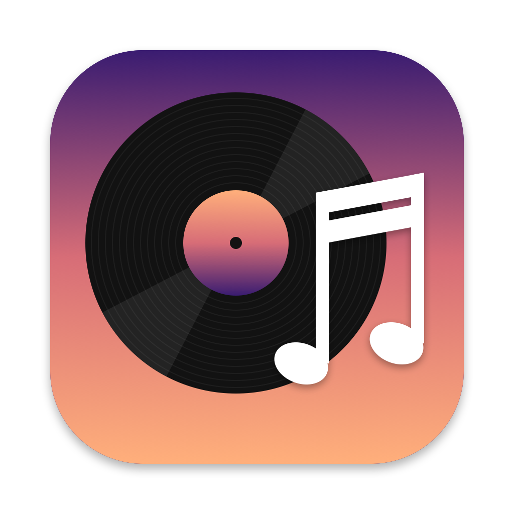
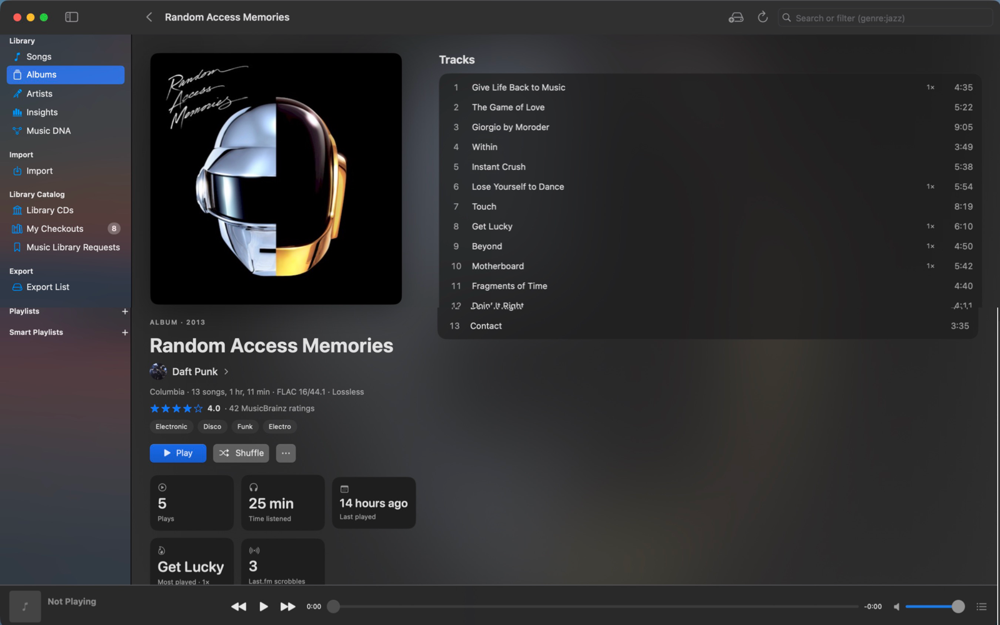
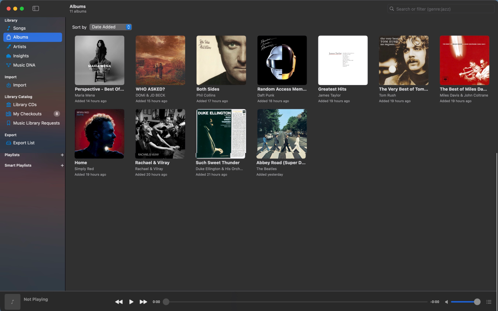
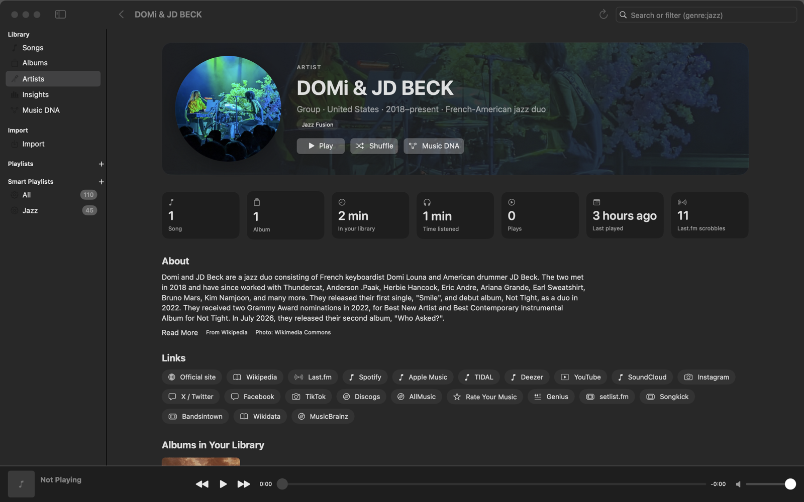
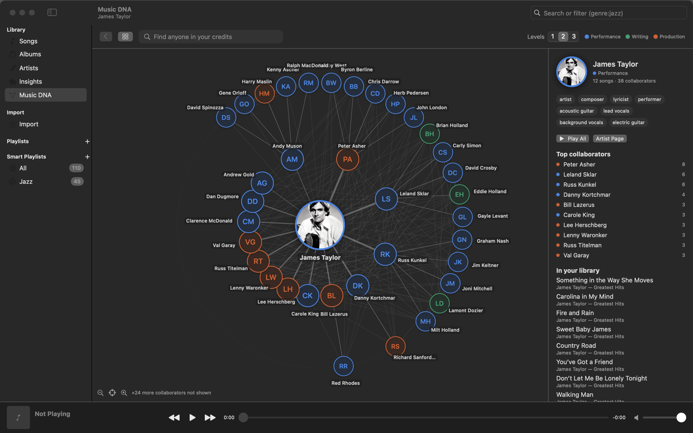
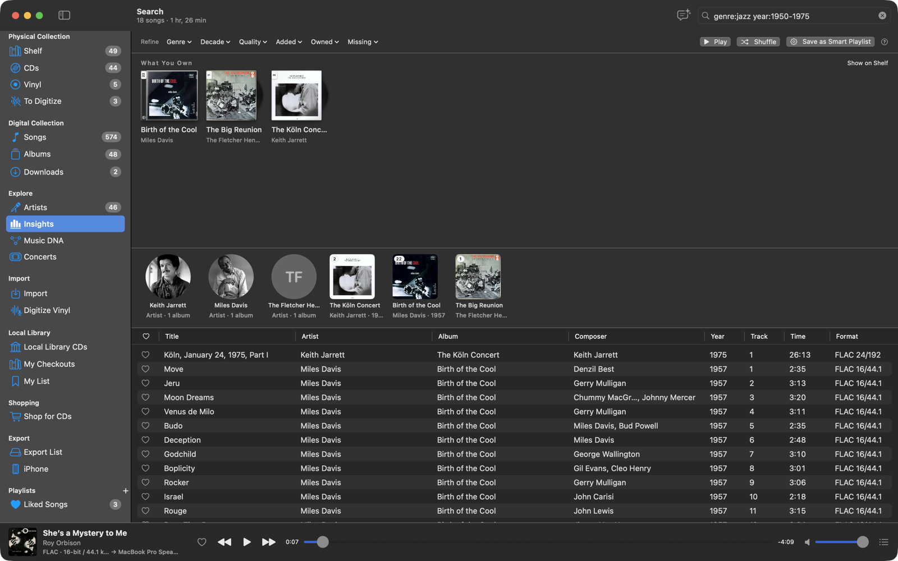
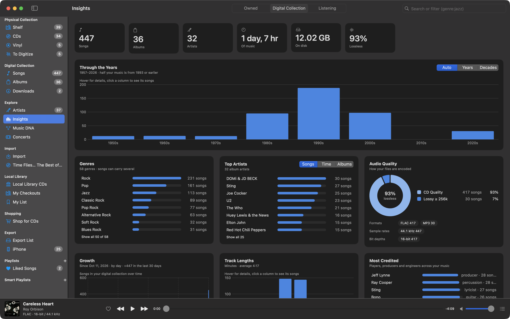
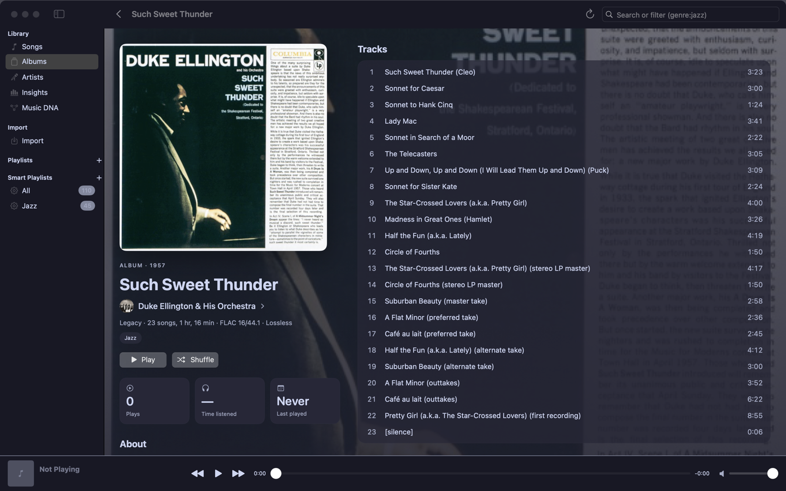
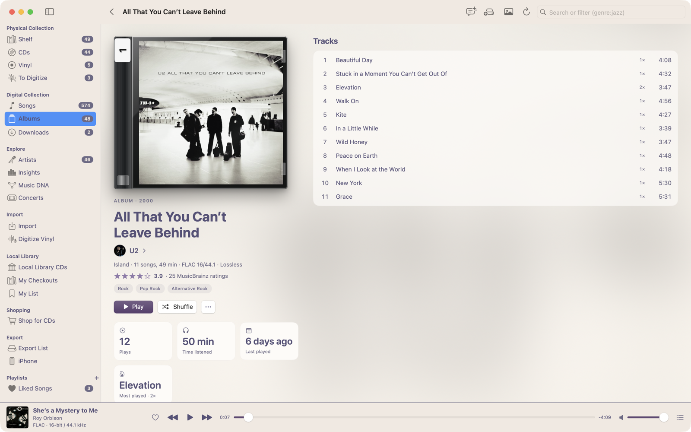

<p align="center">
  
</p>

<h1 align="center">Music Library</h1>

<p align="center">
  A native macOS music library for people who care about their files: import and rip, tag everything from MusicBrainz,
  play bit-perfect, and explore your collection in ways streaming apps don't let you.
</p>

<p align="center">
  <a href="https://github.com/davidlago/music-library/releases/latest"></a>
  <a href="https://github.com/davidlago/music-library/actions/workflows/ci.yml"></a>
  
  <a href="LICENSE"></a>
</p>



## Highlights

- **Import anything, keep it tidy.** Drop in FLAC, MP3, M4A, WAV or AIFF files, or rip a CD straight to FLAC. Tracks are matched against
  [MusicBrainz](https://musicbrainz.org) (optionally by audio fingerprint via AcoustID), tagged with rich metadata and credits, given
  cover art from the Cover Art Archive, and copied into a clean `Artist/Album (Year)/NN - Title` folder. Your original files are never modified.
- **Albums and artists, beautifully.** Album pages show the full release track list (including what you're missing), descriptions,
  community ratings, credits and links to reviews. Artist pages bring photos, bios and links. All of it is fetched once and kept locally.
- **Music DNA.** See who played, wrote and produced with whom across your library, and click your way from one collaborator to the next.
- **Search that understands music.** `genre:jazz year:1955-1965 is:hires`, `credit:"rudy van gelder"`, `added:30d`, `missing:cover`…
  with autocomplete and typo correction. Save any search as a smart playlist that keeps itself up to date.
- **Insights.** Two panes: your collection by decade, genre, artist, audio quality and growth, and your listening (top songs, artists and albums, when you listen, the eras you favor, skips, streaks and favorites to rediscover) over 7 days, 30 days, 12 months or all time. Fun facts in both, all clickable.
- **Bit-perfect playback.** The output device follows each track's sample rate and bit depth, and the original format is restored when you quit.
- **Listening history and Last.fm.** Time listened and plays per album and artist, and optional scrobbling with an offline queue.
- **Themes.** System, Catppuccin (all four flavors, or auto light/dark), Nord, Dracula, Solarized, Gruvbox, Tokyo Night and Rosé Pine.
- **Take it with you.** Add albums, songs, artists and playlists to the Export List and copy them to a USB player
  or drive in the library's own `Music/Artist/Album` layout, covers included. The destination is remembered, and the
  page shows side by side what you're adding and what the drive already has, highlighting what will actually be copied.
  Files already there are never overwritten, and playlists get `.m3u` files. Turn on the database option to also back
  up `library.sqlite` and the artist photos to the drive, for a full library backup.
  A single playlist can still be exported to its own folder.

## Tour

### Albums and artists





### Music DNA

Pick anyone from your credits, or click a name anywhere in the app, to see their collaborators. Click a bubble to put that person
at the center, and choose how many levels of connections to show.



### Search



Plain words search titles, artists, albums, genres, composers, labels and credits. Filters narrow things down:

| Filter | Example |
|---|---|
| Text fields | `artist:radiohead`, `album:blue`, `genre:jazz`, `composer:ellington`, `credit:"teo macero"`, `label:"blue note"` |
| Numbers and ranges | `year:1997`, `year:1990-1999`, `decade:60s`, `time:>10m`, `rate:>=96`, `bits:24`, `bitrate:<256` |
| When added | `added:7d`, `added:>1y`, `added:2025` |
| Flags | `is:lossless`, `is:hires`, `is:compilation`, `is:live`, `is:unmatched` |
| Gaps | `missing:cover`, `missing:year`, `has:credits` |
| Logic | `-live` excludes, `"exact phrase"`, `a OR b` |

Click **?** next to the results for the full reference.

### Insights



### Themes

| Catppuccin Mocha | Rosé Pine Dawn |
|---|---|
|  |  |

## Install

1. Download `MusicLibrary-<version>-macOS.zip` from the [latest release](https://github.com/davidlago/music-library/releases/latest),
   unzip it and drag **MusicLibrary.app** to your Applications folder. It runs natively on Apple Silicon and Intel Macs (macOS 14 or later).
2. **First launch:** the app isn't notarized by Apple, so macOS will refuse to open it the first time. Open
   **System Settings ▸ Privacy & Security**, scroll down and click **Open Anyway**. Alternatively, run:

   ```bash
   xattr -dr com.apple.quarantine /Applications/MusicLibrary.app
   ```

3. **Install ffmpeg**, which the app uses to read and write tags, convert and rip:

   ```bash
   brew install ffmpeg
   ```

   Optional: `brew install chromaprint` for AcoustID fingerprint matching (also needs a free [AcoustID API key](https://acoustid.org/new-application)).

## Getting started

- Your library lives in `~/Music/MusicLibrary` by default; choose another folder in **Settings ▸ General**.
- Import with **File ▸ Import…** (⌘O), by dropping files or folders on the window, or by inserting a CD.
- Add your email under **Settings ▸ General ▸ MusicBrainz**; MusicBrainz asks apps to identify who's making requests.
- To scrobble, create a free [Last.fm API account](https://www.last.fm/api/account/create), enter the key and shared secret in
  **Settings ▸ Last.fm** and click **Connect**.

### Moving to another Mac

Everything that matters is in the library folder: your music, `library.sqlite` (playlists, history, cached info) and `Artist Images`.
Quit the app, copy the folder (to an external drive, for example), and on the new Mac choose it in **Settings ▸ General**.

## Privacy

The library, your listening history and your settings stay on your Mac. The app talks to these services, only to look things up:
MusicBrainz and the Cover Art Archive (matching, covers, artist and album info), Wikipedia, Wikidata and Wikimedia Commons
(descriptions and photos), AcoustID (only if you add a key), and Last.fm (only if you connect it). Downloading artist and album info
can be turned off in **Settings ▸ General**.

## Building from source

You need macOS 14+, Swift 6 (Xcode 16 or later, or the Command Line Tools) and ffmpeg.

```bash
git clone https://github.com/davidlago/music-library.git
cd music-library
scripts/build-app.sh            # builds build/MusicLibrary.app
open build/MusicLibrary.app
swift test                      # runs the test suite (needs ffmpeg)
```

`scripts/build-app.sh` accepts `VERSION=1.2.3` and `UNIVERSAL=1` (Apple Silicon + Intel, needs Xcode). With only the Command Line
Tools installed, see [AGENTS.md](AGENTS.md) for an SDK note.

Releases are built by GitHub Actions: pushing a tag like `v1.2.3` runs the tests, builds a universal app and publishes it on the
Releases page.

## Acknowledgements

Metadata from [MusicBrainz](https://musicbrainz.org) and the [Cover Art Archive](https://coverartarchive.org); descriptions and photos
from [Wikipedia](https://www.wikipedia.org), [Wikidata](https://www.wikidata.org) and [Wikimedia Commons](https://commons.wikimedia.org)
(each photo links to its source and license in the app); fingerprints from [AcoustID](https://acoustid.org); scrobbling via
[Last.fm](https://www.last.fm); audio work by [FFmpeg](https://ffmpeg.org).

## License

[MIT](LICENSE) © 2026 Dave Lago
