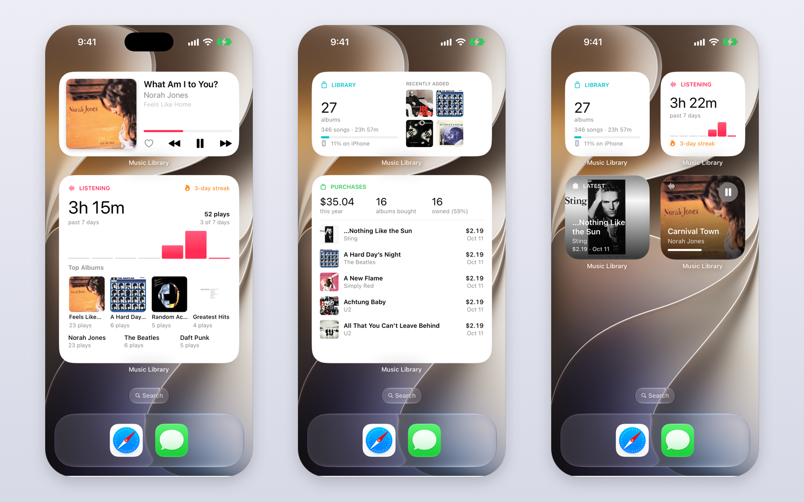

<p align="center">
  
</p>

<h1 align="center">Music Library</h1>

<p align="center">
  A native macOS music library for people who care about their files and their shelves: catalog the CDs, records and
  downloads you own, import and rip, tag everything from MusicBrainz, play bit-perfect, explore your music in ways
  streaming apps don't let you, and find your next CD at your local library.
</p>

<p align="center">
  <a href="https://github.com/davidlago/music-library/releases/latest"></a>
  <a href="https://github.com/davidlago/music-library/actions/workflows/ci.yml"></a>
  
  <a href="https://apps.apple.com/us/app/daves-music-library/id6822005512"></a>
  
  <a href="LICENSE"></a>
</p>

<p align="center"><a href="https://davidlago.github.io/music-library/"><strong>Website</strong></a> ·
  <a href="https://github.com/davidlago/music-library/releases/latest"><strong>Download for Mac</strong></a> ·
  <a href="https://apps.apple.com/us/app/daves-music-library/id6822005512"><strong>iPhone app on the App Store</strong></a></p>


## Highlights

**Catalog what you own**

- **Two collections: physical and digital.** Your **Physical Collection** is the CDs and records on your shelf; your
  **Digital Collection** is your music files, albums you bought as downloads included. Every CD and record is an item
  on the shelf whether or not it's been digitized: CDs you've ripped and ones you haven't, and vinyl (usually never
  digitized). Each item, downloads too, has its own page with the edition, when you bought it and what you paid, and
  links to its digital copy when there is one. See [Your physical collection](#your-physical-collection).
- **A label number on every case and sleeve.** CDs and records each have their own series, both starting at 1, and the
  app never lets you mix them up: the number sits on a white strip across the top of the jewel case's hinge, or
  down the same edge of a record's sleeve, so **CD #12** and **Vinyl #12** are told apart by the case or sleeve
  they're on (the sticker shows just the number), and always written with their series in text. Hover a sticker or a
  badge (on the iPhone, press and hold it) for what it means. The next free number is suggested, and a number already
  taken is refused.
- **Find by Label.** Type a number (⌘L, anywhere in the app) and see what CD #12 is and what sits next to it on the
  shelf, so you can go and grab it. On the iPhone, the Apple Watch (offline) and with Siri too.
- **Add by barcode, link by ripping.** Scan or type the barcode on the case, or a few words of the album and artist, and
  pick the edition from MusicBrainz; add the albums already in your digital collection in bulk. Ripping a CD links the rip to its
  item (or adds it), a CD can be cataloged without ripping it, and **To Digitize** lists what you haven't ripped or
  transferred yet.

**Build your digital collection**

- **Import anything, keep it tidy.** Drop in FLAC, MP3, M4A, WAV or AIFF files and folders. Each track is matched against
  [MusicBrainz](https://musicbrainz.org) (optionally by audio fingerprint via AcoustID); confident matches are applied
  automatically and the rest wait in the Import queue with candidates to pick from. Tracks get rich metadata and credits
  (players, producers, engineers, writers), cover art from the Cover Art Archive, and a clean
  `Artist/Album (Year)/NN - Title` folder. Your original files are never modified.
- **Rip CDs to FLAC, verified.** Insert a disc and it's identified on MusicBrainz by its table of contents; pick the
  release (the app warns when there's no exact match), choose tracks, and they're ripped and imported like any other
  file. Each rip is then checked against [AccurateRip](https://www.accuraterip.com): a track that isn't bit for bit the
  same as other people's rips of the CD was misread, and **Rip Again** replaces it, keeping its plays and likes. Albums
  ripped earlier can be checked from their files too (**Check with AccurateRip** on the album page). The disc can be
  ejected when it's done.

**Explore it**

- **Albums and artists, beautifully.** Album pages show the full release track list (including what you're missing),
  descriptions, community ratings, genres, credits, release details and links to reviews. Artist pages bring photos,
  bios, stats and links to dozens of sites. **Artists** lists everyone in both collections, including artists you only
  own on CD or vinyl. All of it is fetched once and kept locally.
- **Search that understands music.** `genre:jazz year:1955-1965 is:hires`, `credit:"rudy van gelder"`, `added:30d`,
  `missing:cover`… with autocomplete, typo correction, top hits and one-click refinements. Save any search as a smart
  playlist that keeps itself up to date.
- **Music DNA.** See who played, wrote and produced with whom across both your collections (CDs and records with no
  digital copy bring their MusicBrainz credits), and click your way from one collaborator to the next. Any name in the
  app opens it.
- **Insights.** Three panes: **Owned** (your CDs, records and downloads: how much is digitized, your label series with
  their free numbers and duplicates, how you own it by medium, money spent over time, cost per play and per hour, best
  value, what's still in the wrapper, artists, genres, decades and record labels), your **Digital Collection** (by
  decade, genre, artist, audio quality, growth, track length and most-credited people), and your **Listening**, laid
  out like a listening report (plays against the span before, your top artists, albums and songs with their photos and
  covers, what was new to you, a listening clock, the decades and genres you play, skips, streaks and favorites to
  rediscover) over 7 days, 30 days, 12 months or all time. Everything is clickable.
- **Fix missing covers.** Change an album's cover from its page: pick one from MusicBrainz's Cover Art Archive, or use
  an image file, a picture dragged from the web or one you copied. It can be embedded in the album's files too. A new
  cover for a CD or record can go to its album in your digital collection as well, and an album's new cover reaches the
  copies its songs came from.

**Play it**

- **Bit-perfect playback.** The output device follows each track's sample rate and bit depth, and the original format is
  restored when you quit.
- **A real play queue.** Play Next and Add to Queue from any song, album, artist or playlist; the queue panel (⌥⌘U) shows
  what's playing, what's up next and the rest of the list, with drag to reorder. The space bar plays and pauses, and the
  player bar expands into a full Now Playing view.
- **Playlists and smart playlists.** Regular playlists you arrange yourself, and smart ones defined by a search.
- **Listening history and Last.fm.** Plays and time listened per song, album and artist, and optional scrobbling with an
  offline queue.
- **Concerts near you.** Artist pages list their upcoming shows near your ZIP code, and the Concerts page gathers every
  show by an artist in either of your collections, month by month. Listings come from Ticketmaster and JamBase (which
  covers small clubs and independent venues), with free keys for either or both.
- **Shop for CDs.** Find the exact CD on MusicBrainz (by album and artist, or the barcode or catalog number on the case),
  pick the edition, and compare new and used copies that ship to the US on Discogs, eBay, CDandLP and Alibris, with
  shipping and a total in dollars, plus links to search Amazon, Walmart, Half Price Books and Barnes & Noble. No accounts
  or sign-ins. An album's … menu has **Shop for This CD**.

**Local Library CDs**

- **Browse your local library's CDs.** Music CDs from a public library catalog run on Aspen Discovery (like the
  [Minuteman Library Network](https://www.minlib.net)), with the libraries that own each one and what's on the shelf right now.
- **Downloaded and searchable like your music.** Your libraries' whole CD catalogs are downloaded and searched on your Mac
  with the same filters as your digital collection, plus catalog ones: `genre:jazz decade:60s -is:owned is:available`.
- **Real album details.** Each CD is matched on MusicBrainz by its barcode for the cover, track list, year, record label,
  genres, rating and description, and marked when it's already in your digital collection or your physical collection,
  even when the catalog spells it differently.
- **Hear it first.** CDs you don't have play 30-second previews of their songs from Apple Music, with no account or
  sign-in: one song at a time from the track list, or all of them in a row.
- **Your account.** Sign in to see your checkouts (and which you haven't ripped yet) and to add CDs to one of your library
  lists, so you know what to look for on your next visit.

**Make it yours**

- **Themes.** System, Catppuccin (all four flavors, or auto light/dark), Nord, Dracula, Solarized, Gruvbox, Tokyo Night and
  Rosé Pine.
- **Take it with you.** Add albums, songs, artists and playlists to the Export List and copy them to a USB player or drive
  in the library's own `Music/Artist/Album` layout, covers included. The destination is remembered, and the page shows
  side by side what you're adding and what the drive already has, highlighting what will actually be copied. Files already
  there are never overwritten, and playlists get `.m3u` files. Turn on the database option to also back up
  `library.sqlite` and the artist photos to the drive, for a full library backup. A single playlist can still be exported
  to its own folder.
- **An iPhone app.** Browse your whole physical and digital collections on your iPhone (Find by Label, item, album and
  artist pages, Music DNA and Insights, as on the Mac), download the music you want over Wi-Fi from the phone itself, and
  play it offline, through a USB DAC at each song's own sample rate, with the same search, playlists, Liked Songs and
  Last.fm scrobbling. Home and lock screen widgets show your physical collection, your listening and what's playing
  (with controls), and an Apple Watch app is a remote for the phone that also finds a label on your shelf. Free on the [App Store](https://apps.apple.com/us/app/daves-music-library/id6822005512); see [iPhone app](#iphone-app).

## Tour

### Your physical collection

The sidebar has two collections. The **Physical Collection** section at the top is your shelf: **Shelf** (every CD and
record), **CDs**, **Vinyl** and **To Digitize** (the CDs and records with no digital copy yet); it's where the app opens
once you own a CD or record. The **Digital Collection** section below it is your music files: **Songs**, **Albums** and
**Downloads**, the albums you bought as downloads (still things you own, with a purchase date and price, but files
rather than something on a shelf). **Explore** spans both: **Artists** (everyone in either collection; an artist you
only own on CD or vinyl shows "2 albums you own"), **Insights**, **Music DNA** and **Concerts**. Show the shelf as
covers (each CD in its jewel case, each record in its sleeve) or as a list, sorted by label in sections of a hundred, by artist, title, year, purchase date, price or
date added, and filtered with the collection search keys below. **Go to** jumps to a label, and **Label Check** lists
the free numbers and any duplicates in each series.


- **CDs, vinyl and downloads.** Every item has a medium. CDs and vinyl carry a label number in their own series (CD #1,
  CD #2… and Vinyl #1, Vinyl #2…), so CD #12 and Vinyl #12 are two different things; downloads have none. On a cover,
  the white sticker shows just the number and the jewel case or sleeve tells the series; in text, labels are always
  shown with their series. Hover a sticker or badge to see what it means. A number already used in the same series is refused, with the next number and the
  first free one offered instead.
- **Ripped or not.** A CD or record doesn't need any music in your digital collection. Its page says whether it's
  digitized (and from which copy), partly ripped, not ripped yet, or no longer in your digital collection, and offers
  what fits: **Rip Now** when the CD is in a drive, **Import a Transfer…** for a record you digitized yourself, or
  **Link Digital Copy…**.
- **Adding things.** **Add to Physical Collection…** (⇧⌘N, in the File and Physical Collection menus, or the Shelf's
  **+**) asks for the medium (CD, Vinyl or Download) and then the barcode on the case, or a few words of the album and
  artist, and lists the matching editions on MusicBrainz (year, country, record label, catalog number, format,
  barcode) with their covers. Pick one, check the label number, the purchase date and price, and **Add**; **Add &
  Next** keeps going, and a USB barcode scanner makes it one scan and Return per CD. Something MusicBrainz doesn't
  list can be entered by hand. Albums already in your digital collection can be added from their page (**Your Copies ▸
  Add a Copy**), from the Albums grid's menu, or many at once with **Physical Collection ▸ Add Albums You Own…**,
  numbered in the order shown.
- **Ripping links them.** When you insert a CD, its page says which item it is ("This is CD #37 in your physical
  collection, not ripped yet") or offers to add it with the next label. The rip is linked to the item as soon as its
  first track is imported, so a cancelled rip leaves it marked not ripped. **Catalog Without Ripping** adds the CD with
  its cover and ejects it, for the discs you only want on the list. On the Import page, files can be marked as the
  digital copy of a record (a needle-drop) or a CD, and songs you bought can be saved as one album download.
- **Item pages.** The case or sleeve with its label, the release (record label, catalog number, country, format),
  **‹ Previous on Shelf** and **Next on Shelf ›** (⌘[ and ⌘]), the digital copy, the track list (a record's with its
  sides), your copy's details (edited in place: medium, label, bought, paid, notes, edition, cover; a new cover can
  update its digital album's cover too), other copies of the same album, and the album's description, reviews and
  links. An album page lists its **Your Copies** (CDs, records and
  downloads), with what the album has cost you per play.
- **Find by Label** (⌘L): choose CD or Vinyl and type the number. It shows the item, whether it's ripped, and its
  neighbors on the shelf ("between CD #141 and CD #143"); ↑ and ↓ step along the shelf, ⇥ switches series, ↩ opens it.
  Typing a label (`#142`, `cd 142`, `vinyl 12`) in the search field shows it above the results too.
- **Local Library CDs and Shop for CDs** say when you already have a CD ("In your physical collection: CD #142") and
  have **I Own This** to add it.
- **Removing an album from your digital collection keeps the item**: it keeps the album's cover and is marked not
  ripped.


**Coming from an earlier version.** The first time 1.21 opens your library, every album you'd marked as owned becomes
an item you own, with its label number, purchase date and price: a CD on the Shelf, or a download under Downloads. The
albums you bought songs from appear as downloads too. Nothing you filed is lost or changed. Versions before 1.19 didn't
record whether an album was a CD or a download, so albums marked owned with those versions read as CDs: change the
medium on the item's page if one was a download. iPhones with an older version of the app keep showing the CDs and
downloads of the albums in your digital collection, but not your records. If you go back to an older version on the
Mac, what you change there is picked up when you update again, except deleting an album's copy, which has to be done
again; that older version doesn't see the label of a second CD of the same album, so it can suggest a number that's
taken (**Label Check** finds it after updating).

### Albums and artists

**Artists** (in the sidebar's **Explore** section) lists the artists of both collections: someone you only own on CD
or vinyl is there too, and their page shows what's in your physical collection.


### Music DNA

Pick anyone from your credits, or click a name anywhere in the app, to see their collaborators. Click a bubble to put that
person at the center, and choose how many levels of connections to show. It covers both collections: a CD or record
with no digital copy adds its songs' MusicBrainz credits, so a player you only have on vinyl links to the same people as
your music files.


### Search


Plain words search titles, artists, albums, genres, composers, labels and credits. Filters narrow things down:

| Filter | Example |
|---|---|
| Text fields | `artist:radiohead`, `album:blue`, `genre:jazz`, `composer:ellington`, `credit:"teo macero"`, `label:"blue note"` |
| Numbers and ranges | `year:1997`, `year:1990-1999`, `decade:60s`, `time:>10m`, `rate:>=96`, `bits:24`, `bitrate:<256` |
| When added | `added:7d`, `added:>1y`, `added:2025` |
| Flags | `is:lossless`, `is:hires`, `is:compilation`, `is:live`, `is:unmatched` |
| Gaps | `missing:cover`, `missing:year`, `has:credits` |
| Logic | `-live` excludes, `"exact phrase"`, `a OR b` |

Collection keys filter by what you own, for the Shelf, Downloads and your songs (`own:vinyl genre:jazz` lists the songs
of your jazz records):

| Filter | Example |
|---|---|
| Your copy | `own:cd`, `own:vinyl`, `own:download`, `own:physical`, `own:any`; `own:none` = albums in your digital collection you don't own |
| Digitized | `ripped:no`, `ripped:yes`, `ripped:partial`, `ripped:missing`, `ripped:other` (from another copy) |
| Label number | `sticker:12` (either series), `sticker:cd100-199`, `sticker:vinyl>=50`, `sticker:none`; `#12`, `cd#12`, `vinyl#12` in a search box |
| Purchase | `bought:2024`, `bought:90d` (in the last 90 days), `paid:>20`, `paid:none` |
| Release | `copies:>1`, `barcode:886976389413`, `catno:"cl 1355"` |

`label:` still means the record label in the tags. A label number typed on its own (`#142`, `cd 142`) also shows the
item at that label above the results, and a **What You Own** strip lists the CDs, records and downloads that match.

Click **?** next to the results for the full reference, or **Save as Smart Playlist** to keep the search. (iPhone
app versions before 1.21 show a smart playlist that uses collection keys as empty.)

### Insights

The **Owned** pane covers everything you own, CDs, records and downloads: it counts your items and how much of them is
digitized, shows each label series (range, next
number, free numbers and duplicates, with a find field), how you own your music by medium, what you've spent over time
by medium, cost per play and per hour, and lists like Recently Added, To Digitize, Priciest, Best Value and Still in
the Wrapper, with artists, genres, decades and record labels. Rows open the item, and every count opens the Shelf (or
Downloads) filtered to it. The **Digital Collection** pane is about your music files, and **Listening** about what you
play.


### Local Library CDs


Set it up in **Settings ▸ Local Library**: the catalog's address (it defaults to the Natick library in the Minuteman
network), your library, and optionally your card number and PIN. Opening **Local Library CDs** (in the sidebar's
**Local Library** section) downloads every CD your library owns, about a quarter of an hour for a couple of thousand,
then looks each one up on MusicBrainz in the background (a few seconds per CD, the first time only; the local library's
website and MusicBrainz both ask apps to go easy). The download is refreshed when it's more than 12 hours old, for new
titles and current availability. Other libraries can be added, and **Search the Whole Network Live** in the library
menu searches every library on the catalog's website.

The search takes the same filters as your music, with a few catalog meanings and extras:

| Filter | Meaning |
|---|---|
| `title:"so what"` | A song on the CD |
| `time:>60m`, `disc:2` | Album length, number of discs |
| `added:30d` | New in the catalog (since your first download) |
| `is:owned`, `-is:owned` | Already in your digital collection, or not |
| `own:any`, `own:vinyl`, `own:none` | Owned by you (on CD or vinyl, or as a download), or not |
| `is:available`, `is:out` | On the shelf at your library right now, or not |
| `is:onlist` | On the library list you chose in Settings |
| `library:acton`, `rating:>=4` | Owned by a library; MusicBrainz community rating |

`is:owned` is about your digital collection, `own:` about what you own (your physical collection and downloads): a CD
you own but haven't ripped is `own:cd -is:owned`.

### On the iPhone

Both your collections. The **Physical** tab (your Physical Collection) finds a label (CD or Vinyl and a number, with
its neighbors on the shelf) and lists your CDs, vinyl and what's left to digitize, with the Mac's item pages; **Ready
to Download** gathers the items whose music is on the Mac but not on the phone. The **Digital** tab (your Digital
Collection, with your Downloads) has the Mac's album pages (description, rating, the full track list, release details,
credits, your copies) and artist pages (bio, links, concerts near you, albums, most played), plus playlists and a Now
Playing screen that shows the file's format and the rate your DAC is running at, with gapless playback between songs at
the same rate. **Insights** opens with **Explore**: **Artists** (everyone in both collections) and **Music DNA**. Music
that isn't on the phone is dimmed: tap **Download** and the phone fetches it from the Mac over Wi-Fi, or **Remove from
iPhone** to free the space.


### Widgets and Apple Watch

Home screen widgets show what's playing (with play/pause, skip and like buttons that work without opening the app), how
much you've listened lately with your streak and top albums, your physical collection with what you added lately and
your next labels, and your digital collection at a glance. The Apple Watch app is a remote for the iPhone's player with
your listening, and its **Physical** page counts your CDs and records ("34 CDs · 5 records"), lists what you added
lately and finds a label on your shelf with the Digital Crown, even away from the phone; its complications show your
listening time, the song playing and your physical collection.




### Themes

| Catppuccin Mocha | Rosé Pine Dawn |
|---|---|
|  |  |

## Install

Download `MusicLibrary-<version>-macOS.zip` from the [latest release](https://github.com/davidlago/music-library/releases/latest),
unzip it and drag **MusicLibrary.app** to your Applications folder. It runs natively on Apple Silicon and Intel Macs
(macOS 14 or later). From 1.13.0 the app is signed and notarized by Apple, so it opens like any other app, and it
includes the ffmpeg, ffprobe and fpcalc it uses to read and write tags, rip CDs and fingerprint songs: there's nothing
else to install. (Earlier releases needed **Open Anyway** in **System Settings ▸ Privacy & Security** and
`brew install ffmpeg`; you can uninstall Homebrew's ffmpeg once you've updated, unless something else uses it.)

The first time a new version reads your saved keys and passwords, macOS may ask to allow access to the keychain; choose
**Always Allow**.

For the iPhone and Apple Watch, get [Dave's Music Library](https://apps.apple.com/us/app/daves-music-library/id6822005512)
from the App Store (see [iPhone app](#iphone-app)).

## iPhone app

The iPhone app shows your whole physical and digital collections and plays a copy of part of your digital collection,
offline. Get it free on the App Store as
[Dave's Music Library](https://apps.apple.com/us/app/daves-music-library/id6822005512)
(iOS 27 or later; the Apple Watch app comes with it). To try it without the Mac app, tap **Explore a Sample Library** on
the screen it opens on (or its Digital tab): fictional albums built into the app, replaced by your own library after
your first sync.

**Build it yourself (optional)**

To run your own build instead, install it on your phone from Xcode, which takes a few one-time steps.
You need a Mac with Xcode 27 or later, an iPhone on iOS 27 or later with a USB cable, and an Apple ID (a free one works).

1. On the iPhone, turn on **Settings ▸ Privacy & Security ▸ Developer Mode** (the phone restarts), then connect it to the
   Mac and tap **Trust**.
2. Get the source (see [Building from source](#building-from-source)) and open `iOS/MusicLibraryMobile.xcodeproj` in Xcode.
   Sign in with your Apple ID in **Xcode ▸ Settings ▸ Accounts** if you haven't.
3. Set your team: select the **MusicLibraryMobile** target, open **Signing & Capabilities** and pick your team (with a free
   Apple ID, "Your Name (Personal Team)"). To keep the project file unchanged, put it in `iOS/Local.xcconfig` instead,
   which isn't committed:

   ```
   DEVELOPMENT_TEAM = ABCDE12345
   APP_BUNDLE_ID = com.yourname.MusicLibraryMobile
   ```

   A bundle identifier can belong to only one developer, so if Xcode says it isn't available, choose your own as above.
   The widgets, the Apple Watch app and the app group they share with the app are named after it, and Xcode registers
   them for your team.
4. Pick your iPhone as the run destination and click **Run** (⌘R).
5. The first time, iOS won't open an app from an unknown developer: on the phone, open
   **Settings ▸ General ▸ VPN & Device Management**, tap your Apple ID under Developer App and tap **Trust**.

**Sync music over Wi-Fi**

1. Pair once: on the iPhone, open the **Sync** tab and tap **Pair with a Mac**. In the Mac app, choose **iPhone** in the
   sidebar, type the code the iPhone shows next to its name and click **Pair**. Both need to be on the same Wi-Fi network
   (allow local network access when each asks).
2. Every sync sends the whole library's details to the phone (every album and artist, their covers and photos, the info
   the Mac looked up, your listening history and everything you own, with its covers), so you can browse all of it
   there. Only the music you choose is copied.
3. Choose that music on the phone: open any album, artist or playlist and tap **Download**, or **Remove from iPhone**
   (also in long-press menus, and per song). With Music Library open on the Mac and both on the same Wi-Fi, the phone
   syncs right away; otherwise what you asked for waits (in the Sync tab) until the Mac is around. Removing deletes the
   songs from the phone at once and tells the Mac to stop syncing them. Or choose it on the Mac with **Add to iPhone** in
   any album, artist, playlist or song menu; the Mac's **iPhone** page shows the list, including what was taken off the
   phone, and **Sync Now** there works while the iPhone's Sync tab is open. Its **Owned Music on iPhone** setting, per
   phone, also puts the digital copies of what you own on it: **Digitized CDs**, **Digitized vinyl** or **Everything I
   own that's digitized** (downloads included). New rips join at the next sync, and **Remove from iPhone** still wins.
4. Each sync also brings back what you did on the phone: songs you liked or unliked there and what you listened to, so
   the Mac's Liked Songs, Insights and album pages include the phone. What you own shows on the phone read-only,
   with labels, dates and prices; you add and edit it in the Mac app. If the Mac is connected to Last.fm and the
   phone isn't, the sync connects the phone with the Mac's account; the Mac's concert settings come along too, for
   concerts on artist pages.

For a big first load, copying through Finder is faster than Wi-Fi: export the list to a folder with the database option
on, select the iPhone in Finder's sidebar, open the **Files** tab and drag the folder onto **Music Library**. Later syncs
then send only what changed.

**Use it**

- **Physical** (your Physical Collection, where the app opens once you own a CD or record) has **Find by Label** at
  the top: pick CD or Vinyl, type the number and see what it is, whether it's ripped and what's on either side of it on
  the shelf. Below are your CDs, vinyl, **To Digitize**, **Ready to Download** (with **Download All**) and what you
  added lately. Items with
  no digital copy show at full brightness with a disc or record mark, never dimmed or with a Download button: there's
  nothing to download until you rip or digitize them on the Mac. Press and hold a cover's sticker or badge to see what
  it means. With Siri or Shortcuts, say "Find CD 12 in Music Library".
- **Digital** (your Digital Collection) lists all your music, with your **Downloads**; switch it to **On This iPhone**
  to see only what you can play right now. Albums, artists
  and songs that aren't on the phone are dimmed: tap one to download it, or long-press anything for **Download to
  iPhone** or **Remove from iPhone**. What's waiting for the Mac is listed in the Sync tab.
- **Insights** starts with **Explore**: **Artists**, everyone in both collections (artists you only own on CD or vinyl
  included), and **Music DNA** (also opened from an artist page or any credited name). Album and artist pages, Music
  DNA and Insights work without the music being on the phone, from what the Mac last synced. Songs you like go back to the Mac at the next
  sync. Your copies (on album pages and item pages) are read-only on the phone: edit them in the Mac app.
- With a USB DAC connected, each song plays at its own sample rate (16/44.1, 24/96, 24/192…); Now Playing shows where it's
  going and at what rate. For bit-perfect output keep the iPhone's volume at maximum and use the DAC's or amplifier's.
  Unplugging the DAC pauses instead of switching to the speaker.
- Settings (the gear on the Digital tab) has the sample-rate switch and Last.fm (connected from the Mac at the first sync,
  or enter the API key and shared secret and tap **Connect…**). The phone scrobbles what it plays itself, and scrobbles
  made offline are sent when it's back online; the Mac doesn't scrobble them again.
- The play queue and position are kept when the app is closed.

**Widgets**

Long-press the home screen, tap **Edit ▸ Add Widget** and search for Music Library. The widgets show what the app last
saw, so open the app once after installing (and after a sync) to fill them in:

- **Listening**: time listened in the past 7 or 30 days (long-press ▸ **Edit Widget** to choose), a bar per day, your
  streak, and your top artist, song and albums. Also on the lock screen.
- **Now Playing**: the song with play/pause (and previous, next and like on the medium size), which work without opening
  the app; with nothing queued, **Shuffle** plays what's on the phone. Also on the lock screen.
- **Physical Collection**: the latest CD or record you added in its case or sleeve with its label, how many CDs and
  records you have and how many CDs are left to rip, your next free labels (CD and Vinyl), and on the large size this
  year's spending. Also on the lock screen ("312 CDs · 48 vinyl", "Next label: CD #313").
- **Rediscover**: a song you played a lot and haven't heard in three months, a different one every couple of hours, with
  **Play** for its album.
- **Digital Collection**: albums, songs and hours of music, how much of it is on the phone, and what was added last.

Tapping a widget opens the app on its album, item, Now Playing or Insights.

**Apple Watch**

The watch app (watchOS 26 or later) installs with the iPhone app (or from the Watch app on the phone, under **Available Apps**). It's a remote
for the iPhone's player (play/pause, previous, next, like, and starting Liked Songs, a shuffle, or an album from your
most played, Rediscover and recently added) and shows your listening. Its **Physical** page counts your CDs and
records ("34 CDs · 5 records"), lists what you added lately and the CDs left to rip, and has **Find**: pick CD or Vinyl
and turn the Digital Crown to a label to see what it is and its neighbors, even away from the phone (the phone sends the
watch an index of your labeled items, usually as soon as you open the watch app with the phone nearby). Its complications show listening time, the song playing and your physical collection. It shows what the phone last
sent, so the phone app must have run since; commands and covers need the phone nearby.

**Every 7 days (free Apple ID)**

Apps installed with a free Apple ID stop opening after 7 days. Connect the phone and click **Run** in Xcode again: the new
build installs over the old one and keeps your music, database, Last.fm account and queue. Don't delete the app from the
home screen, which deletes its music too. A paid Apple Developer Program membership makes installs last a year.

## Getting started

- Your library lives in `~/Music/MusicLibrary` by default; choose another folder in **Settings ▸ General**.
- Import with **File ▸ Import…** (⌘O), by dropping files or folders on the window, or by inserting a CD.
- Catalog the CDs and records you own with **File ▸ Add to Physical Collection…** (⇧⌘N), or add the albums already in
  your digital collection with **Physical Collection ▸ Add Albums You Own…**.
- Add your email under **Settings ▸ General ▸ MusicBrainz**; MusicBrainz asks apps to identify who's making requests.
- To match songs by their audio fingerprint, add a free [AcoustID API key](https://acoustid.org/new-application) in
  **Settings ▸ General ▸ AcoustID**.
- To scrobble, create a free [Last.fm API account](https://www.last.fm/api/account/create), enter the key and shared secret in
  **Settings ▸ Last.fm** and click **Connect**.
- For concerts near you, open **Settings ▸ Concerts**, enter your ZIP code and add a free
  [Ticketmaster](https://developer.ticketmaster.com/products-and-docs/apis/getting-started/) and/or [JamBase](https://data.jambase.com) API key
  (for Ticketmaster, the Consumer Key of the app in your developer account).
- For your local library's CDs, open **Settings ▸ Local Library**, check the catalog address and your library, and sign
  in if you'd like your checkouts and lists.

### Moving to another Mac

Everything that matters is in the library folder: your music (with your items' own covers in
`Music/Collection Covers`), `library.sqlite` (what you own, playlists, history, cached info and the downloaded local
library catalog) and `Artist Images`. Quit the app, copy the folder (to an external drive, for example), and on
the new Mac choose it in **Settings ▸ General**.

## Privacy

The library, your listening history and your settings stay on your Mac. The app talks to these services, only to look
things up: MusicBrainz and the Cover Art Archive (matching, covers, artist and album info), Wikipedia, Wikidata and
Wikimedia Commons (descriptions and photos), AcoustID (only if you add a key), Last.fm (only if you connect it), and your
local library's catalog website (only once you open Local Library CDs; your card number and PIN are sent only to that
site), and Apple's iTunes Search API (only when you open a local library CD you don't have, for its song previews), Apple's geocoder (to
find your ZIP code), and Ticketmaster and JamBase (only with your keys; they receive your artists' names and the area
you're searching, not your ZIP code). API keys,
secrets and your PIN are kept in your keychain. Downloading artist and album info can be turned off in
**Settings ▸ General**, and looking up local library CDs in **Settings ▸ Local Library**.

The iPhone app keeps its music and the copied database on the phone, out of iCloud backups. Its widgets and the watch app
get a small summary (stats, recent additions to your physical collection, the song playing and a few covers) kept on the phone
and sent to your paired watch, which also gets an index of your labeled CDs and records (titles, artists, years and
label numbers) for Find by Label. It talks to Last.fm, if you
connect it, to Ticketmaster and JamBase for concerts on artist pages (only if the Mac has keys for them), and to the Mac
app it's paired with, over your local network: syncs are encrypted with a key the two exchange when pairing. While the
Mac app runs it listens on the local network for its paired phones (macOS may ask to allow incoming connections).

## Building from source

You need macOS 14+, Swift 6 (Xcode 16 or later, or the Command Line Tools), ffmpeg (`brew install ffmpeg`, for the
tests and `swift run`) and cmake (`brew install cmake`, to build the copy of ffmpeg that goes inside the app).

```bash
git clone https://github.com/davidlago/music-library.git
cd music-library
scripts/build-app.sh            # builds build/MusicLibrary.app
open build/MusicLibrary.app
swift test                      # runs the test suite (needs ffmpeg)
```

`scripts/build-app.sh` builds FFmpeg and Chromaprint from source the first time (`scripts/build-tools.sh`, about a
minute) and puts ffmpeg, ffprobe and fpcalc inside the app; `BUNDLE_TOOLS=0` leaves them out, and the app then uses
Homebrew's. It also accepts `VERSION=1.2.3`, `UNIVERSAL=1` (Apple Silicon + Intel, needs Xcode) and `SIGN_IDENTITY=…`
(a signing certificate; one with a Team ID keeps keychain access across rebuilds). With only the Command Line Tools
installed, see [AGENTS.md](AGENTS.md) for an SDK note.

The iPhone app is `iOS/MusicLibraryMobile.xcodeproj` (needs Xcode), with its widgets and the Apple Watch app; it shares
`MusicLibraryCore` with the Mac app.
See [iPhone app](#iphone-app) for installing it on a phone.

Releases are built by GitHub Actions: pushing a tag like `v1.2.3` runs the tests, builds a universal app, signs it with a
Developer ID certificate, has Apple notarize it and publishes it on the Releases page, and uploads the iPhone app to
TestFlight (`scripts/testflight.sh` does that by hand). [docs/distribution.md](docs/distribution.md) has the one-time setup for both.

## Acknowledgements

Metadata from [MusicBrainz](https://musicbrainz.org) and the [Cover Art Archive](https://coverartarchive.org); descriptions and photos
from [Wikipedia](https://www.wikipedia.org), [Wikidata](https://www.wikidata.org) and [Wikimedia Commons](https://commons.wikimedia.org)
(each photo links to its source and license in the app); fingerprints from [AcoustID](https://acoustid.org); scrobbling via
[Last.fm](https://www.last.fm); concert listings from [Ticketmaster](https://www.ticketmaster.com) and
[JamBase](https://www.jambase.com); audio work by [FFmpeg](https://ffmpeg.org) and fingerprinting by [Chromaprint](https://acoustid.org/chromaprint), both
included in the app under the LGPL (their licenses are in `MusicLibrary.app/Contents/Resources/Licenses`); library
catalogs by
[Aspen Discovery](https://aspendiscovery.org).

## License

[MIT](LICENSE) © 2026 Dave Lago
