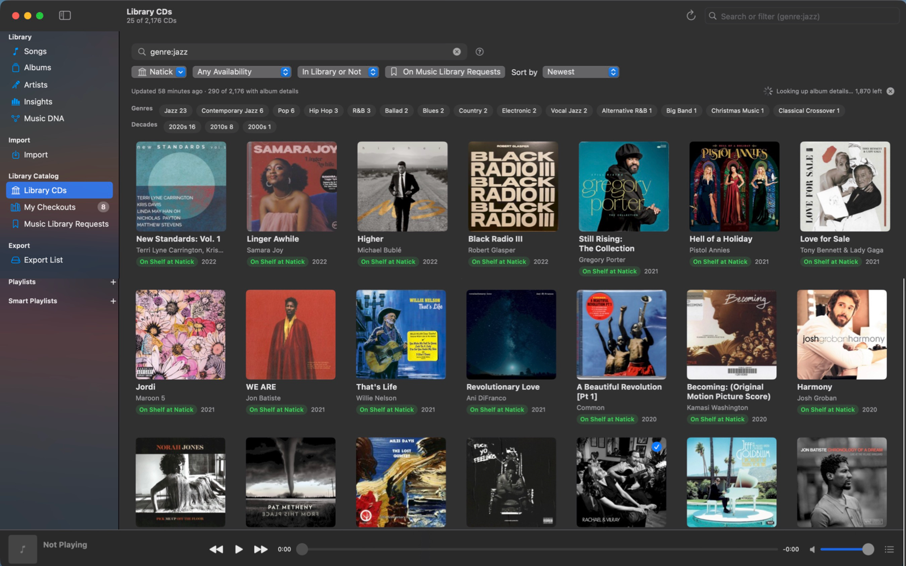
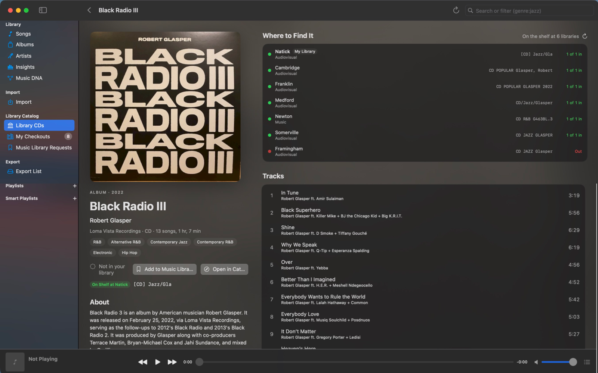

<p align="center">
  
</p>

<h1 align="center">Music Library</h1>

<p align="center">
  A native macOS music library for people who care about their files: import and rip, tag everything from MusicBrainz,
  play bit-perfect, explore your collection in ways streaming apps don't let you, and find your next CD at the public library.
</p>

<p align="center">
  <a href="https://github.com/davidlago/music-library/releases/latest"></a>
  <a href="https://github.com/davidlago/music-library/actions/workflows/ci.yml"></a>
  
  
  <a href="LICENSE"></a>
</p>


## Highlights

**Build the library**

- **Import anything, keep it tidy.** Drop in FLAC, MP3, M4A, WAV or AIFF files and folders. Each track is matched against
  [MusicBrainz](https://musicbrainz.org) (optionally by audio fingerprint via AcoustID); confident matches are applied
  automatically and the rest wait in the Import queue with candidates to pick from. Tracks get rich metadata and credits
  (players, producers, engineers, writers), cover art from the Cover Art Archive, and a clean
  `Artist/Album (Year)/NN - Title` folder. Your original files are never modified.
- **Rip CDs to FLAC.** Insert a disc and it's identified on MusicBrainz by its table of contents; pick the release (the app
  warns when there's no exact match), choose tracks, and they're ripped and imported like any other file. The disc can be
  ejected when it's done.

**Explore it**

- **Albums and artists, beautifully.** Album pages show the full release track list (including what you're missing),
  descriptions, community ratings, genres, credits, release details and links to reviews. Artist pages bring photos,
  bios, stats and links to dozens of sites. All of it is fetched once and kept locally.
- **Search that understands music.** `genre:jazz year:1955-1965 is:hires`, `credit:"rudy van gelder"`, `added:30d`,
  `missing:cover`… with autocomplete, typo correction, top hits and one-click refinements. Save any search as a smart
  playlist that keeps itself up to date.
- **Music DNA.** See who played, wrote and produced with whom across your library, and click your way from one
  collaborator to the next. Any name in the app opens it.
- **Insights.** Three panes: your collection (by decade, genre, artist, audio quality, growth, track length and most-credited
  people), your listening (top songs, artists and albums, activity over time, when you listen, the genres and eras you
  play, skips, streaks and favorites to rediscover) over 7 days, 30 days, 12 months or all time, and the albums you own
  (money spent over time, average price, cost per play and per hour, top artists, best value and unplayed purchases).
  Everything is clickable.
- **Fix missing covers.** Change an album's cover from its page: pick one from MusicBrainz's Cover Art Archive, or use
  an image file, a picture dragged from the web or one you copied. It can be embedded in the album's files too.
- **Albums you own.** Mark an album as yours on its page, with when you bought it and what you paid; ripping a CD asks
  the same.

**Play it**

- **Bit-perfect playback.** The output device follows each track's sample rate and bit depth, and the original format is
  restored when you quit.
- **A real play queue.** Play Next and Add to Queue from any song, album, artist or playlist; the queue panel (⌥⌘U) shows
  what's playing, what's up next and the rest of the list, with drag to reorder. The space bar plays and pauses, and the
  player bar expands into a full Now Playing view.
- **Playlists and smart playlists.** Regular playlists you arrange yourself, and smart ones defined by a search.
- **Listening history and Last.fm.** Plays and time listened per song, album and artist, and optional scrobbling with an
  offline queue.
- **Concerts near you.** Artist pages list their upcoming shows near your ZIP code, and the Concerts page gathers every
  show by an artist in your library, month by month. Listings come from Ticketmaster and JamBase (which covers small
  clubs and independent venues), with free keys for either or both.

**Your public library's CDs**

- **Browse the catalog.** Music CDs from a public library catalog run on Aspen Discovery (like the
  [Minuteman Library Network](https://www.minlib.net)), with the libraries that own each one and what's on the shelf right now.
- **Downloaded and searchable like your music.** Your libraries' whole CD catalogs are downloaded and searched on your Mac
  with the same filters as your library, plus catalog ones: `genre:jazz decade:60s -is:owned is:available`.
- **Real album details.** Each CD is matched on MusicBrainz by its barcode for the cover, track list, year, label, genres,
  rating and description, and marked when it's already in your library, even when the catalog spells it differently.
- **Hear it first.** CDs you don't have play 30-second previews of their songs from Apple Music, with no account or
  sign-in: one song at a time from the track list, or all of them in a row.
- **Your account.** Sign in to see your checkouts (and which you haven't ripped yet) and to add CDs to one of your library
  lists, so you know what to look for on your next visit.

**Make it yours**

- **Themes.** System, Catppuccin (all four flavors, or auto light/dark), Nord, Dracula, Solarized, Gruvbox, Tokyo Night and
  Rosé Pine.
- **Take it with you.** Add albums, songs, artists and playlists to the Export List and copy them to a USB player or drive
  in the library's own `Music/Artist/Album` layout, covers included. The destination is remembered, and the page shows
  side by side what you're adding and what the drive already has, highlighting what will actually be copied. Files already
  there are never overwritten, and playlists get `.m3u` files. Turn on the database option to also back up
  `library.sqlite` and the artist photos to the drive, for a full library backup. A single playlist can still be exported
  to its own folder.
- **An iPhone app.** Copy part of the library to your iPhone and play it offline, through a USB DAC at each song's own
  sample rate, with the same search, playlists, Liked Songs, covers and Last.fm scrobbling. See [iPhone app](#iphone-app).

## Tour

### Albums and artists


### Music DNA

Pick anyone from your credits, or click a name anywhere in the app, to see their collaborators. Click a bubble to put that
person at the center, and choose how many levels of connections to show.


### Search


Plain words search titles, artists, albums, genres, composers, labels and credits. Filters narrow things down:

| Filter | Example |
|---|---|
| Text fields | `artist:radiohead`, `album:blue`, `genre:jazz`, `composer:ellington`, `credit:"teo macero"`, `label:"blue note"` |
| Numbers and ranges | `year:1997`, `year:1990-1999`, `decade:60s`, `time:>10m`, `rate:>=96`, `bits:24`, `bitrate:<256` |
| When added | `added:7d`, `added:>1y`, `added:2025` |
| Flags | `is:lossless`, `is:hires`, `is:compilation`, `is:live`, `is:unmatched` |
| Gaps | `missing:cover`, `missing:year`, `has:credits` |
| Logic | `-live` excludes, `"exact phrase"`, `a OR b` |

Click **?** next to the results for the full reference, or **Save as Smart Playlist** to keep the search.

### Insights


### Library CDs





Set it up in **Settings ▸ Library**: the catalog's address (it defaults to the Natick library in the Minuteman network), your
library, and optionally your card number and PIN. Opening **Library CDs** downloads every CD your library owns, about a
quarter of an hour for a couple of thousand, then looks each one up on MusicBrainz in the background (a few seconds per CD,
the first time only; the library's website and MusicBrainz both ask apps to go easy). The download is refreshed when it's
more than 12 hours old, for new titles and current availability. Other libraries can be added, and
**Search the Whole Network Live** in the library menu searches every library on the catalog's website.

The search takes the same filters as your music, with a few catalog meanings and extras:

| Filter | Meaning |
|---|---|
| `title:"so what"` | A song on the CD |
| `time:>60m`, `disc:2` | Album length, number of discs |
| `added:30d` | New in the catalog (since your first download) |
| `is:owned`, `-is:owned` | Already in your music library, or not |
| `is:available`, `is:out` | On the shelf at your library right now, or not |
| `is:onlist` | On the library list you chose in Settings |
| `library:acton`, `rating:>=4` | Owned by a library; MusicBrainz community rating |

### On the iPhone

Albums, artists, songs, playlists and search, a Now Playing screen that shows the file's format and the rate your DAC is
running at, and gapless playback between songs at the same rate.


### Themes

| Catppuccin Mocha | Rosé Pine Dawn |
|---|---|
|  |  |

## Install

1. Download `MusicLibrary-<version>-macOS.zip` from the [latest release](https://github.com/davidlago/music-library/releases/latest),
   unzip it and drag **MusicLibrary.app** to your Applications folder. It runs natively on Apple Silicon and Intel Macs (macOS 14 or later).
2. **First launch:** the app isn't notarized by Apple, so macOS will refuse to open it the first time. Open
   **System Settings ▸ Privacy & Security**, scroll down and click **Open Anyway**. Alternatively, run:

   ```bash
   xattr -dr com.apple.quarantine /Applications/MusicLibrary.app
   ```

3. **Install ffmpeg**, which the app uses to read and write tags, convert and rip:

   ```bash
   brew install ffmpeg
   ```

   Optional: `brew install chromaprint` for AcoustID fingerprint matching (also needs a free [AcoustID API key](https://acoustid.org/new-application)).

When a new version first reads your saved keys and passwords, macOS asks once to allow access to the keychain; choose
**Always Allow**.

## iPhone app

The iPhone app plays a copy of part of your library, offline. It's an early companion: there's no App Store version yet,
so you build it with Xcode and install it on your own phone, which takes a few one-time steps.

**What you need:** a Mac with Xcode 27 or later, an iPhone on iOS 27 or later with a USB cable, and an Apple ID (a free one
works).

**Install it**

1. On the iPhone, turn on **Settings ▸ Privacy & Security ▸ Developer Mode** (the phone restarts), then connect it to the
   Mac and tap **Trust**.
2. Get the source (see [Building from source](#building-from-source)) and open `iOS/MusicLibraryMobile.xcodeproj` in Xcode.
   Sign in with your Apple ID in **Xcode ▸ Settings ▸ Accounts** if you haven't.
3. Set your team: select the **MusicLibraryMobile** target, open **Signing & Capabilities** and pick your team (with a free
   Apple ID, "Your Name (Personal Team)"). To keep the project file unchanged, put it in `iOS/Local.xcconfig` instead,
   which isn't committed:

   ```
   DEVELOPMENT_TEAM = ABCDE12345
   PRODUCT_BUNDLE_IDENTIFIER = com.yourname.MusicLibraryMobile
   ```

   A bundle identifier can belong to only one developer, so if Xcode says it isn't available, choose your own as above.
4. Pick your iPhone as the run destination and click **Run** (⌘R).
5. The first time, iOS won't open an app from an unknown developer: on the phone, open
   **Settings ▸ General ▸ VPN & Device Management**, tap your Apple ID under Developer App and tap **Trust**.

**Add music**

1. In the Mac app, add albums, artists, playlists or songs to the Export List, turn on the database option, and export to
   a folder (for example one named `Music Library`).
2. Connect the iPhone, select it in Finder's sidebar, open the **Files** tab and drag the exported folder onto
   **Music Library**.
3. Open the app. It shows only the songs that are on the phone; export more and drag the folder in again to add albums.

**Use it**

- With a USB DAC connected, each song plays at its own sample rate (16/44.1, 24/96, 24/192…); Now Playing shows where it's
  going and at what rate. For bit-perfect output keep the iPhone's volume at maximum and use the DAC's or amplifier's.
  Unplugging the DAC pauses instead of switching to the speaker.
- Settings (the gear on the Library tab) has the sample-rate switch and Last.fm: enter the same API key and shared secret
  as on the Mac and tap **Connect…**. Scrobbles made offline are sent when the phone is back online.
- The play queue and position are kept when the app is closed.

**Every 7 days (free Apple ID)**

Apps installed with a free Apple ID stop opening after 7 days. Connect the phone and click **Run** in Xcode again: the new
build installs over the old one and keeps your music, database, Last.fm account and queue. Don't delete the app from the
home screen, which deletes its music too. A paid Apple Developer Program membership makes installs last a year.

## Getting started

- Your library lives in `~/Music/MusicLibrary` by default; choose another folder in **Settings ▸ General**.
- Import with **File ▸ Import…** (⌘O), by dropping files or folders on the window, or by inserting a CD.
- Add your email under **Settings ▸ General ▸ MusicBrainz**; MusicBrainz asks apps to identify who's making requests.
- To scrobble, create a free [Last.fm API account](https://www.last.fm/api/account/create), enter the key and shared secret in
  **Settings ▸ Last.fm** and click **Connect**.
- For concerts near you, open **Settings ▸ Concerts**, enter your ZIP code and add a free
  [Ticketmaster](https://developer.ticketmaster.com/products-and-docs/apis/getting-started/) and/or [JamBase](https://data.jambase.com) API key
  (for Ticketmaster, the Consumer Key of the app in your developer account).
- For your public library's CDs, open **Settings ▸ Library**, check the catalog address and your library, and sign in if
  you'd like your checkouts and lists.

### Moving to another Mac

Everything that matters is in the library folder: your music, `library.sqlite` (playlists, history, cached info and the
downloaded library catalog) and `Artist Images`. Quit the app, copy the folder (to an external drive, for example), and on
the new Mac choose it in **Settings ▸ General**.

## Privacy

The library, your listening history and your settings stay on your Mac. The app talks to these services, only to look
things up: MusicBrainz and the Cover Art Archive (matching, covers, artist and album info), Wikipedia, Wikidata and
Wikimedia Commons (descriptions and photos), AcoustID (only if you add a key), Last.fm (only if you connect it), and your
library's catalog website (only once you open Library CDs; your card number and PIN are sent only to that site), and
Apple's iTunes Search API (only when you open a library CD you don't have, for its song previews), Apple's geocoder (to
find your ZIP code), and Ticketmaster and JamBase (only with your keys; they receive your artists' names and the area
you're searching, not your ZIP code). API keys,
secrets and your PIN are kept in your keychain. Downloading artist and album info can be turned off in
**Settings ▸ General**, and looking up library CDs in **Settings ▸ Library**.

The iPhone app keeps its music and the copied database on the phone, out of iCloud backups. It talks only to Last.fm, if
you connect it.

## Building from source

You need macOS 14+, Swift 6 (Xcode 16 or later, or the Command Line Tools) and ffmpeg.

```bash
git clone https://github.com/davidlago/music-library.git
cd music-library
scripts/build-app.sh            # builds build/MusicLibrary.app
open build/MusicLibrary.app
swift test                      # runs the test suite (needs ffmpeg)
```

`scripts/build-app.sh` accepts `VERSION=1.2.3`, `UNIVERSAL=1` (Apple Silicon + Intel, needs Xcode) and `SIGN_IDENTITY=…`
(a signing certificate; one with a Team ID keeps keychain access across rebuilds). With only the Command Line Tools
installed, see [AGENTS.md](AGENTS.md) for an SDK note.

The iPhone app is `iOS/MusicLibraryMobile.xcodeproj` (needs Xcode); it shares `MusicLibraryCore` with the Mac app.
See [iPhone app](#iphone-app) for installing it on a phone.

Releases are built by GitHub Actions: pushing a tag like `v1.2.3` runs the tests, builds a universal app and publishes it on the
Releases page.

## Acknowledgements

Metadata from [MusicBrainz](https://musicbrainz.org) and the [Cover Art Archive](https://coverartarchive.org); descriptions and photos
from [Wikipedia](https://www.wikipedia.org), [Wikidata](https://www.wikidata.org) and [Wikimedia Commons](https://commons.wikimedia.org)
(each photo links to its source and license in the app); fingerprints from [AcoustID](https://acoustid.org); scrobbling via
[Last.fm](https://www.last.fm); concert listings from [Ticketmaster](https://www.ticketmaster.com) and
[JamBase](https://www.jambase.com); audio work by [FFmpeg](https://ffmpeg.org); library catalogs by
[Aspen Discovery](https://aspendiscovery.org).

## License

[MIT](LICENSE) © 2026 Dave Lago
