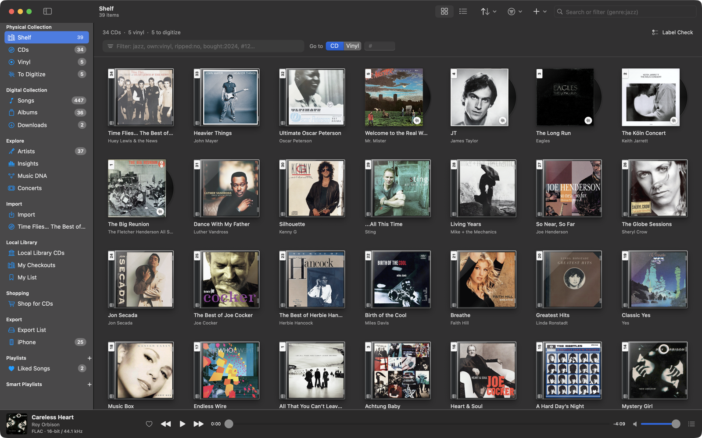
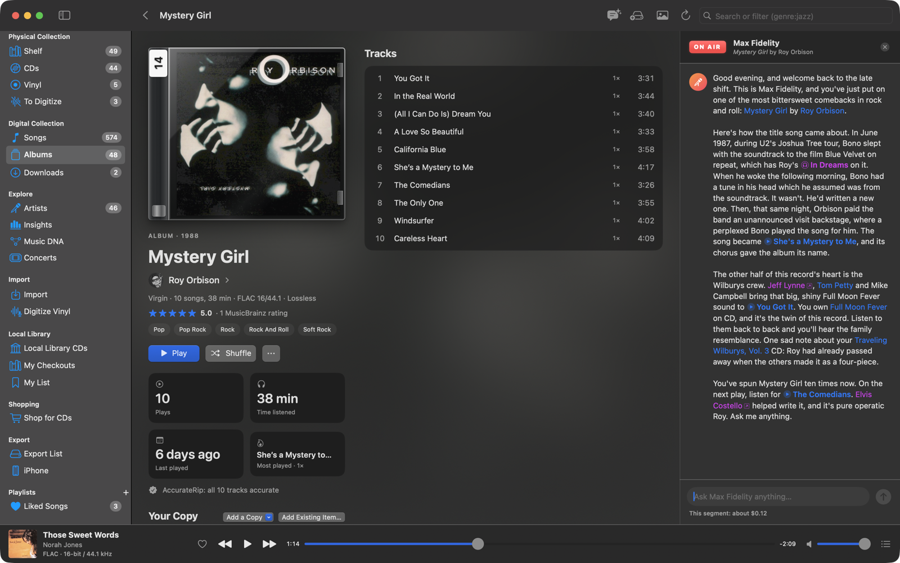
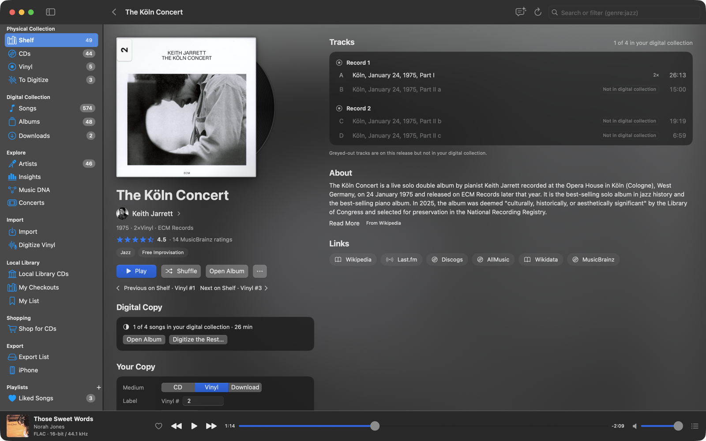
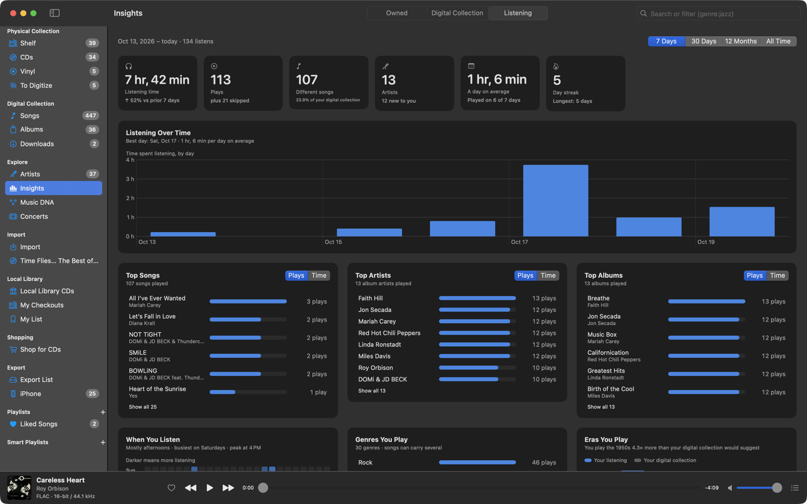
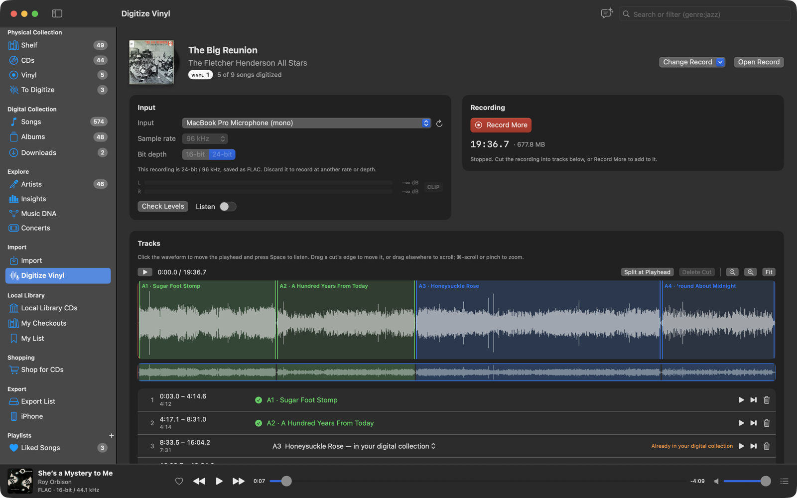
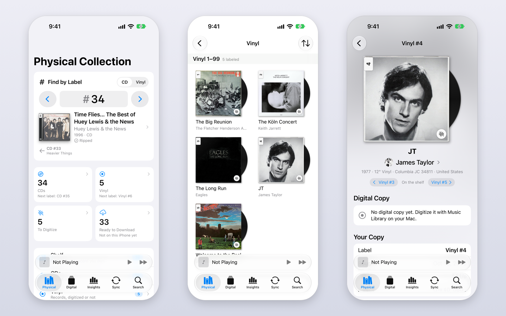
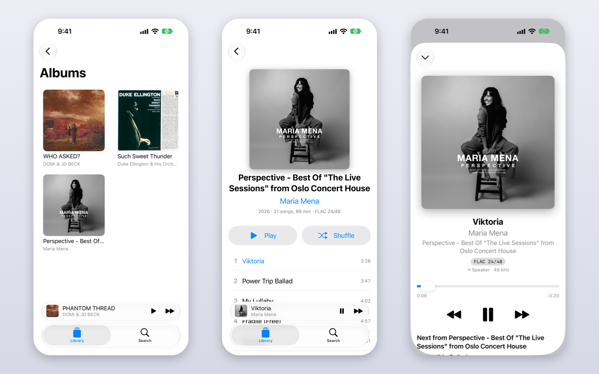
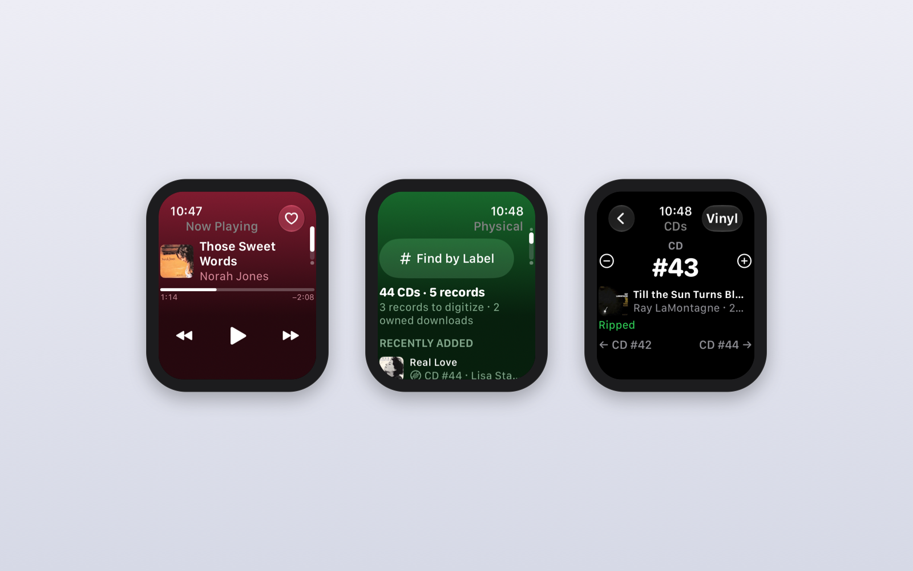

<p align="center">
  
</p>

<h1 align="center">Music Library</h1>

<p align="center">
  Your CDs, your records and your music files, finally in one place. A free, native Mac app with a companion for iPhone
  and Apple Watch, for people who own their music.
</p>

<p align="center">
  <a href="https://github.com/davidlago/music-library/releases/latest"></a>
  <a href="https://github.com/davidlago/music-library/actions/workflows/ci.yml"></a>
  
  <a href="https://apps.apple.com/us/app/daves-music-library/id6822005512"></a>
  
  <a href="LICENSE"></a>
</p>

<p align="center"><a href="https://davidlago.github.io/music-library/"><strong>Website</strong></a> ·
  <a href="https://github.com/davidlago/music-library/releases/latest"><strong>Download for Mac</strong></a> ·
  <a href="https://apps.apple.com/us/app/daves-music-library/id6822005512"><strong>iPhone app</strong></a> ·
  <a href="docs/guide/README.md"><strong>Documentation</strong></a></p>



Music Library keeps two collections side by side. Your **Physical Collection** is the CDs and records on your shelf, each
with a label number so you can always find it, whether or not you've ripped it. Your **Digital Collection** is your music
files: ripped, digitized from vinyl, imported or bought as downloads, all tagged from MusicBrainz and filed neatly. On top
of both: rich album and artist pages, a search language that understands music, Music DNA, Insights, bit-perfect
playback, and a Claude-powered radio DJ who tells you the story behind every record.

## What it does

- **Catalog what you own.** Add CDs, records and downloads by barcode, give every case a label number (CD #12 and
  Vinyl #12 are never mixed up), and find any of them with **Find by Label** on the Mac, iPhone, Apple Watch or with
  Siri. [Physical Collection →](docs/guide/physical-collection.md)
- **Build your digital collection.** Import files matched on MusicBrainz, rip CDs to FLAC checked bit for bit against
  AccurateRip, and record your records from the turntable into tracks.
  [Importing →](docs/guide/importing.md) · [Ripping CDs →](docs/guide/ripping-cds.md) ·
  [Digitizing vinyl →](docs/guide/digitizing-vinyl.md)
- **Explore it.** Album and artist pages with credits, descriptions and ratings; search like
  `genre:jazz decade:60s own:vinyl`; Music DNA maps who played with whom; Insights shows what you own, what your files
  are made of and how you listen. [Albums and artists →](docs/guide/albums-and-artists.md) ·
  [Search →](docs/guide/search.md) · [Music DNA →](docs/guide/music-dna.md) · [Insights →](docs/guide/insights.md)
- **Put a DJ on the air.** With your own Claude API key (or an OpenRouter key for any model it serves), press **On Air** and your DJ tells you about what you're looking
  at, answers questions, checks the web and searches your own collection. Show it a photo of a record or CD (on iPhone,
  straight from the camera) to find out what it is, whether you have it and what to pay.
  [Radio DJ →](docs/guide/radio-dj.md)
- **Play it properly.** Each song at its own sample rate and bit depth, a real play queue, playlists and smart playlists,
  and Last.fm scrobbling. [Playback →](docs/guide/playback.md)
- **Find more music.** Concerts near you by your artists, your public library's CD catalog downloaded and searchable,
  and new and used CDs and records compared across stores. [Concerts →](docs/guide/concerts.md) ·
  [Local Library CDs →](docs/guide/local-library.md) · [Shop →](docs/guide/shop.md)
- **Take it with you.** The iPhone app browses both collections and plays what you sync to it, offline and through a USB
  DAC at each song's rate, with widgets and an Apple Watch app. Export to a USB player or back up to a drive.
  [iPhone app →](docs/guide/iphone.md) · [Widgets and Apple Watch →](docs/guide/widgets-and-watch.md) ·
  [Export and backup →](docs/guide/export-and-backup.md)

## A closer look

| | |
|---|---|
|  |  |
| **Radio DJ**: the story behind the record, with links to what you own | **Item pages**: every CD and record, digitized or not |
|  |  |
| **Music DNA**: the people behind your music | **Insights**: a listening report, plus what you own and your files |
|  |  |
| **Digitize Vinyl**: record a side, cut it into tracks, save as FLAC | **Search**: filters, what you own, smart playlists |







## Install

**Mac** (macOS 14 or later, Apple silicon and Intel): download `MusicLibrary-<version>-macOS.zip` from the
[latest release](https://github.com/davidlago/music-library/releases/latest), unzip it and drag **MusicLibrary.app** to
Applications. It's signed and notarized, and includes everything it needs. Then see
[Getting started](docs/guide/getting-started.md).

**iPhone and Apple Watch** (iOS 26 / watchOS 26 or later): get
[Dave's Music Library](https://apps.apple.com/us/app/daves-music-library/id6822005512) free on the App Store, then pair
it with the Mac from **Sync** on its Listen Now tab. No Mac app yet? Tap **Explore a Sample Library** to try it.

## Documentation

The [user guide](docs/guide/README.md) (also [on the website](https://davidlago.github.io/music-library/docs/)) covers
every feature: [Getting started](docs/guide/getting-started.md), [Physical Collection](docs/guide/physical-collection.md),
[Importing](docs/guide/importing.md), [Ripping CDs](docs/guide/ripping-cds.md),
[Digitizing vinyl](docs/guide/digitizing-vinyl.md), [Albums and artists](docs/guide/albums-and-artists.md),
[Search](docs/guide/search.md), [Insights](docs/guide/insights.md), [Music DNA](docs/guide/music-dna.md),
[Radio DJ](docs/guide/radio-dj.md), [Concerts](docs/guide/concerts.md), [Playback](docs/guide/playback.md),
[Local Library CDs](docs/guide/local-library.md), [Shop](docs/guide/shop.md),
[Export and backup](docs/guide/export-and-backup.md), [iPhone app](docs/guide/iphone.md),
[Widgets and Apple Watch](docs/guide/widgets-and-watch.md), [Settings](docs/guide/settings.md),
[Privacy](docs/guide/privacy.md), [Troubleshooting](docs/guide/troubleshooting.md) and
[Building from source](docs/guide/building-from-source.md). What changed in each version is in the
[changelog](CHANGELOG.md).

## Privacy

No account, no cloud service, no ads, no tracking. Your library and listening history stay on your Mac and iPhone, which
sync directly over your Wi-Fi, encrypted. The app talks to MusicBrainz, Wikipedia and the other services only to look
things up, and to Last.fm, Ticketmaster, JamBase, Claude or OpenRouter only with your own keys. Details in
[Privacy](docs/guide/privacy.md).

## Building from source

```bash
git clone https://github.com/davidlago/music-library.git
cd music-library
scripts/build-app.sh            # builds build/MusicLibrary.app
swift test                      # runs the test suite (needs ffmpeg)
```

Swift 6, no third-party dependencies. The iPhone app is `iOS/MusicLibraryMobile.xcodeproj`. See
[Building from source](docs/guide/building-from-source.md) for the details, and [AGENTS.md](AGENTS.md) for the
architecture.

## Acknowledgements

Metadata from [MusicBrainz](https://musicbrainz.org) and the [Cover Art Archive](https://coverartarchive.org);
descriptions and photos from [Wikipedia](https://www.wikipedia.org), [Wikidata](https://www.wikidata.org),
[Wikimedia Commons](https://commons.wikimedia.org) and [Deezer](https://www.deezer.com) (each photo links to its source
and license in the app); fingerprints from [AcoustID](https://acoustid.org); rip checks from
[AccurateRip](https://www.accuraterip.com); scrobbling via [Last.fm](https://www.last.fm); concert listings from
[Ticketmaster](https://www.ticketmaster.com) and [JamBase](https://www.jambase.com); song previews from Apple Music; the
Radio DJ by [Claude](https://www.anthropic.com/claude); audio work by [FFmpeg](https://ffmpeg.org) and fingerprinting by
[Chromaprint](https://acoustid.org/chromaprint), both included in the app under the LGPL (their licenses are in
`MusicLibrary.app/Contents/Resources/Licenses`); library catalogs by [Aspen Discovery](https://aspendiscovery.org).

## License

[MIT](LICENSE) © 2026 Dave Lago
