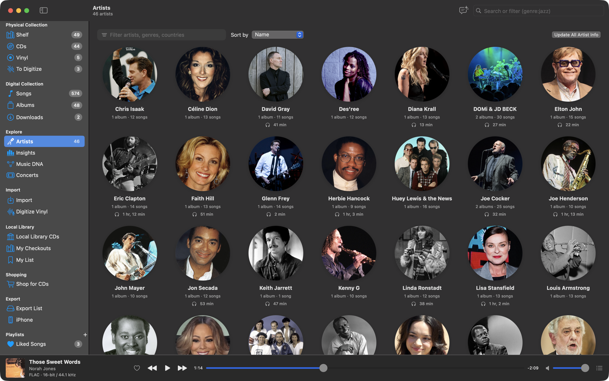

# Albums and artists

Album and artist pages bring together your music, what you own, how you listen and what the world knows about it, all
looked up once and kept in your library.

## Albums

**Albums** (Digital Collection) shows every album as a cover, each in the case or sleeve you own it in. **Owned** filters
it (All Albums, Albums You Own, Albums You Don't Own), and **Sort by** orders it by date added, title, artist, release
year, most played or recently played.

An album page has:

- The cover in the case or sleeve you own it in, with its label.
- The release: record label, length, format and quality ("FLAC 16/44.1 · Lossless"), the MusicBrainz community rating
  and genres.
- **Play**, **Shuffle** and **…** (Play Next, Add to Queue, **Check with AccurateRip**, **Shop for This CD**, **Remove
  from Digital Collection…**).
- Your listening: plays, time listened, last played, the most played song and your Last.fm scrobbles.
- **Your Copies**: the CDs, records and downloads you own, and what the album has cost you per play.
- **About**: a description from Wikipedia; **Reviews**: links to reviews; **Release**: label, catalog number, barcode,
  country, dates; **Credits**: everyone who played on, wrote, produced or engineered it (click a name for
  [Music DNA](music-dna.md)); **Links**.
- **Tracks**: the release's full track list, including songs you don't have (dimmed), with plays and likes.

The toolbar has **Add to Export List**, **Add to iPhone**, **Change Cover…** and **Update Album Info**.

## Artists

**Artists** (Explore) lists everyone in both your collections: an artist you only own on CD or vinyl is there too ("2
albums you own"). Filter by name, genre or country, and sort by name, songs, albums, time listened or recently played.

An artist page has:

- Their photo, type, country and years, and genres.
- **Play**, **Shuffle**, **Music DNA** and **…**.
- Stats: songs, albums, copies you own, time in your digital collection, time listened, plays, last played, Last.fm
  scrobbles.
- **About** (from Wikipedia) and **Links** to dozens of sites: official site, Wikipedia, Last.fm, streaming services,
  Discogs, AllMusic, setlist.fm, Songkick and more.
- **Concerts Near You** (see [Concerts](concerts.md)).
- **In Your Physical Collection** and **In Your Digital Collection**, and their **Most Played** songs.

## Where the information comes from

Artist and album info comes from MusicBrainz (relationships, genres, ratings, credits), Wikidata, Wikipedia
(descriptions) and Wikimedia Commons (photos), plus Last.fm when it's connected. It's fetched the first time you open a
page (or all at once with **Update All Now** in Settings ▸ General) and kept in your library database, so pages open
instantly and work offline, also on the iPhone. Turn off **Download artist photos, bios, album descriptions and links
automatically** in Settings ▸ General to skip it.

## Covers

**Change Cover…** (album page toolbar, hovering over the cover, or dropping an image on it) finds covers on the Cover
Art Archive for the album's release and similar releases, or takes an image file, a picture dragged from a web page, or
one you copied. The cover is converted to JPEG (at most 1600 px), saved as the album's `cover.jpg`, and optionally
embedded in its files.

A CD or record in your Physical Collection can have a cover of its own (its exact edition), set on its page; it can go
to the digital album too, and an album's new cover reaches the copies its songs came from.

## Artist photos

**Change Photo…** (artist page toolbar, hovering over the photo, dropping an image on it, or the Artists grid's context
menu) offers photos from Deezer and Wikimedia Commons, listing the artist's own Deezer picture and Wikipedia images
first, or takes a file, a dragged image or the clipboard. The photo you pick is kept even when the artist's info is
updated.
