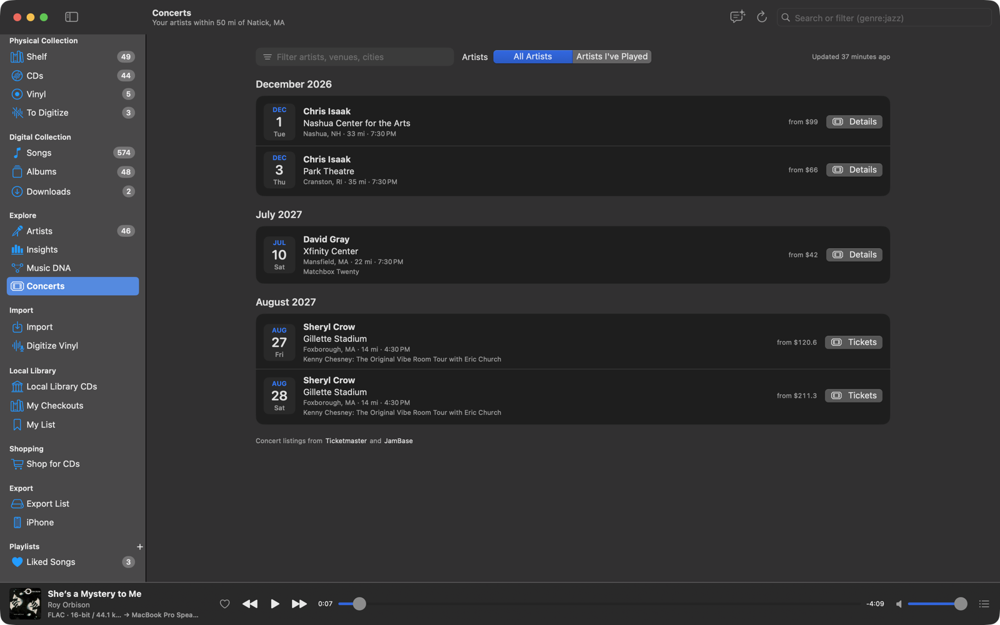

# Concerts

Music Library lists upcoming concerts near you by the artists in your collections: on each artist page, and all
together on the **Concerts** page (Explore).

## Set it up

Open **Settings ▸ Concerts**:

1. **Where you live**: enter your ZIP code (or postal code outside the US) and press Return; the app looks it up with
   Apple's geocoder and shows the place it found. Choose a **Distance** (10 to 200 miles or km; 50 by default).
2. **Concert listings**: add a free key for either or both services.
   - **Ticketmaster**: arenas, theaters and larger clubs. Create an app in your
     [Ticketmaster developer account](https://developer.ticketmaster.com/products-and-docs/apis/getting-started/) and copy
     its Consumer Key (the Consumer Secret isn't needed).
   - **JamBase**: venue calendars, including small clubs and independent venues, better for smaller bands. Free for
     personal use ([data.jambase.com](https://data.jambase.com), 1,000 requests a month).
3. **Artist pages**: **Show upcoming concerts on artist pages** (on by default).

Keys are kept in your keychain. A show listed by both services appears once.

## On artist pages

**Concerts Near You** lists the artist's next shows within your distance: date, venue, city, the lineup, and the price
range when known, with **Tickets** or **Details** links. **Show All N Concerts** expands the list, and **All dates on
Ticketmaster/JamBase** opens their full tour.

## The Concerts page

Every upcoming show nearby by an artist in either of your collections, month by month. Filter by artist, venue or city,
or switch to **Artists I've Played** to see only artists you listen to. **Refresh** looks again.

## How it stays within the free limits

Results are saved for a day per artist, and two days for the whole-library scan. Ticketmaster is searched month by month
for every music event near you and matched to your artists; JamBase is asked about many artists per request. Error
messages never include your keys.

The iPhone app shows concerts on its artist pages with the settings and keys the Mac hands over at each sync.

Listings from JamBase are credited to it, as its free plan asks.
