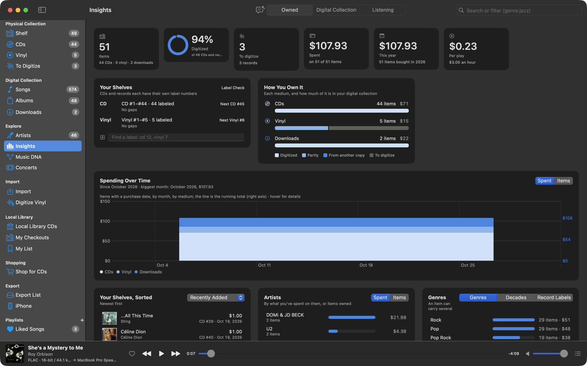

# Insights

**Insights** (Explore) has three panes: **Owned** (everything you own), **Digital Collection** (your music files) and
**Listening** (what you play). Everything in them is clickable: a count opens the Shelf, Downloads or a search filtered
to it, and a row opens its album, artist or item. The same panes are on the iPhone.

## Owned

Your CDs, records and downloads.

- **Totals**: items, how much is digitized, what's left to digitize, what you've spent (in all and this year) and the
  cost per play and per hour listened.
- **Your Shelves**: each label series (CD and Vinyl) with its range, the next number, free numbers and duplicates, a
  find field, and **Label Check**.
- **How You Own It**: per medium, how many items are digitized, partly digitized, digitized from another copy or not yet.
- **Spending Over Time**, by medium, by month or year, with a running total.
- Lists: Recently Added, To Digitize, Priciest, Best Value (most plays for the money) and Still in the Wrapper (never
  played).
- What you own by artist, genre, decade and record label, by money spent or by items.

Prices are in your Mac's currency. Plays count once per album, whichever copy they came from.

## Digital Collection

Your music files.

Totals (songs, albums, artists, length, size, how much is lossless), **Through the Years** (by release year or decade),
**Genres**, **Top Artists** (by songs, time or albums), **Audio Quality** (hi-res, CD quality, lossy; formats, sample
rates and bit depths), **Growth** over time, **Track Lengths** and the **Most Credited** players, producers and
engineers.

## Listening

A listening report, inspired by Last.fm's, over **7 Days**, **30 Days**, **12 Months** or **All Time**.

- **The banner**: plays and time listened over a blurred photo of your top artist, each day's plays next to the same
  span before, and how much more or less you listened.
- **Top Charts**: your number one artist, album and song up big with their photo or cover (each panel takes its color
  from the picture), then the next four, ranked by plays or time.
- **New to You**: how many of the artists, albums and songs you played were new, with the top one of each.
- **Patterns**: a Listening Clock dial with your busiest hour and day, plays per hour, and Music by Decade with your
  favorite decade's top album, against what's in your library.
- **Quick Facts**: listening time, plays a day, your most active day, days with music, skips and streaks, compared with
  the span before.
- **Forgotten favorites**: songs you played a lot and haven't heard in a while.

Plays from the iPhone are included after each sync.
