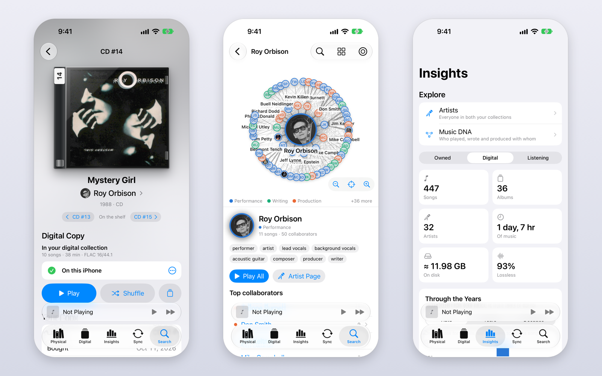

# iPhone app

**Dave's Music Library** for iPhone (free on the
[App Store](https://apps.apple.com/us/app/daves-music-library/id6822005512), iOS 26 or later, with the Apple Watch app)
shows both your collections and plays the music you choose to keep on the phone, offline. It gets everything from the
Mac app over your Wi-Fi network, encrypted, with no account or cloud service in between, and, with
[iCloud backup](icloud.md) turned on on the Mac, from your own iCloud when the Mac isn't nearby.

## Try it first

No Mac app yet? Tap **Explore a Sample Library** on the first screen: fictional artists, CDs and records built into the
app (the songs were synthesized and the covers drawn for it), so you can try everything. Nothing you do in the sample is
sent anywhere, and your own library replaces it after your first sync (or tap **Hide Sample Library**).

## Pair once

1. On the iPhone, open the **Sync** tab and tap **Pair with a Mac**. It shows a pairing code.
2. In the Mac app, choose **iPhone** in the sidebar, type the code next to the phone's name and click **Pair**.
3. Allow local network access when each device asks.

Both need to be on the same Wi-Fi network. The code is used once to exchange a key that only your two devices know;
every sync after that is encrypted with it. To pair with another Mac, use **Pair Again** on the phone.

## What syncs

Every sync sends the whole library's details: every album and artist with their covers and photos, the info the Mac
looked up, your playlists, your listening history and everything you own with its covers. So you can browse all of it on
the phone, even the music that isn't there. Only the music you choose is copied.

Each sync also brings back what you did on the phone: songs you liked or unliked and what you listened to, so the Mac's
Liked Songs, Insights and album pages include the phone. What you own is shown on the phone read-only; add and edit it
in the Mac app. When the Mac is connected to Last.fm and the phone isn't, the sync connects the phone with the Mac's
account, and the Mac's concert settings and Radio DJ key come along too.

## Choosing the music on the phone

- **On the phone**: open any album, artist or playlist and tap **Download**, or **… ▸ Remove from iPhone** (also in
  long-press menus, and per song). Tapping a song that isn't on the phone offers **Download Song** or **Download Album**.
  The Collection tab's **Ready to Download** lists the CDs and records you've digitized that aren't on the phone, with
  **Download All**.
- **On the Mac**: **Add to iPhone** in any album, artist, playlist or song menu. The Mac's **iPhone** page shows the
  list, including what was taken off the phone ("Kept off the iPhone").
- **Owned Music on iPhone** (per phone, on the Mac's iPhone page) also puts the digital copies of what you own on it:
  **Digitized CDs**, **Digitized vinyl** or **Everything I own that's digitized** (downloads included). New rips join at
  the next sync, and Remove from iPhone still wins.

With Music Library open on the Mac and both on the same Wi-Fi, the phone syncs right away. Otherwise, with
[iCloud backup](icloud.md#on-the-iphone) on, songs that are in your Mac's iCloud backup download from there; the rest
wait in Sync ("Waiting for the Mac") until the Mac is around. **Sync Now** works from either side while the
phone's Sync screen is open. Removing deletes the songs from the phone at once. The first sync from a Mac asks before
deleting anything.

Keep the app open while it syncs: iOS pauses it in the background.

### A big first load

Copying through Finder is faster than Wi-Fi for a big library: on the Mac, [export](export-and-backup.md) the music to a
folder with the database option on, then select the iPhone in Finder's sidebar, open its **Files** tab and drag the
folder onto **Music Library**. Later syncs send only what changed.

## The tabs

### Listen Now

Where the app opens. It leads with the album that's playing (or the one you played last), tinted by its cover, with
**Play** and **Shuffle**, then **Keep Listening** (the albums you've been playing), the album's neighbors **Beside It on
the Shelf**, **Your Week** in four numbers, and **Up Next**. The buttons at the top open **Sync** and **Settings**.

### Collection

Both collections on one tab: the CDs and records you own first, then your digital collection.

- **Find by Label**: pick CD or Vinyl, type the number (or step with ‹ ›) and see what it is, whether it's ripped and
  what's on either side of it on the shelf.
- **CDs**, **Vinyl** (with the next free label), **To Digitize**, **Ready to Download**, and the **Shelf**, as covers or
  a list, sorted and filtered ("Filter, or a label like 12").
- Item pages like the Mac's: the case or sleeve, previous and next on the shelf, the digital copy, tracks, your copy's
  details and other copies.
- **Digital Collection**: **Albums**, **Songs**, **Liked Songs**, **Downloads** and your playlists. Switch between
  **All Music** and **On This iPhone**. Music that isn't on the phone is dimmed; tap it to download it. With nothing on
  the shelf, the tab is just this list.

Items with no digital copy are shown at full brightness with a disc or record badge, never dimmed and never with a
Download button: there's nothing to download until you rip or digitize them. Press and hold a sticker or badge to see
what it means.

Album and artist pages have what the Mac's have: description, rating, the full track list, release details, credits,
your copies, plays, links, and concerts near you. They take their color from the cover or the artist's photo.

### Explore

**Artists** (everyone in both collections) and **Music DNA** at the top. Below, the **Owned**, **Digital** and
**Listening** panes of Insights, as on the Mac.

### Search

The same search language as the Mac, including `own:` and labels like `cd 12`.

### Sync

The **Sync** button at the top of Listen Now pairs and syncs, and lists what's waiting for the Mac and the last sync. The
phone looks for the Mac's syncs only while Sync is open.

## Playing

- Gapless playback between songs at the same sample rate, lock screen and Control Center controls, and a play queue with
  Play Next that's kept when the app closes.
- **With a USB DAC**, each song plays at its own sample rate (16/44.1, 24/96, 24/192…): before each song the phone
  switches its output to the song's rate. Now Playing shows the file's format and the rate the output is running at,
  and warns when it was resampled. For bit-perfect output keep the iPhone's volume at maximum and use the DAC's or
  amplifier's.
- Plugging in a DAC mid-song restarts the song at its rate; unplugging pauses instead of switching to the speaker.
- Liked Songs, scrobbling and the Radio DJ work as on the Mac.

## Settings

The gear at the top of Listen Now (and of the Collection tab):

- **Appearance**: **System** (follows your iPhone's light or dark setting), **Light** or **Dark**.
- **Match the DAC's sample rate** (on by default) and the current output.
- **Radio DJ**: the DJ's name, yours, and this phone's spending (set up on the Mac; see [Radio DJ](radio-dj.md)).
- **Last.fm**: connected from the Mac at the first sync, or enter an API key and shared secret and tap **Connect…**. The
  phone scrobbles what it plays itself; scrobbles made offline are sent when it's back online.
- **iCloud**: **Use iCloud** (on), when the library was last updated from your Mac's iCloud backup, and **Check Now**
  (see [iCloud backup](icloud.md#on-the-iphone)).
- **Music Library**: songs on the phone, what you own, **Reload Music Library**, and the sample library.

## Siri and Shortcuts

"Find CD 12 in Music Library" (or "Where is Vinyl 3 in Music Library", "What's CD 140 in Music Library") says which
item has that label and opens it. **Find by Label** is also an action in Shortcuts.

## Build it yourself

You can run your own build instead of the App Store's; see
[Building from source](building-from-source.md#the-iphone-app).
