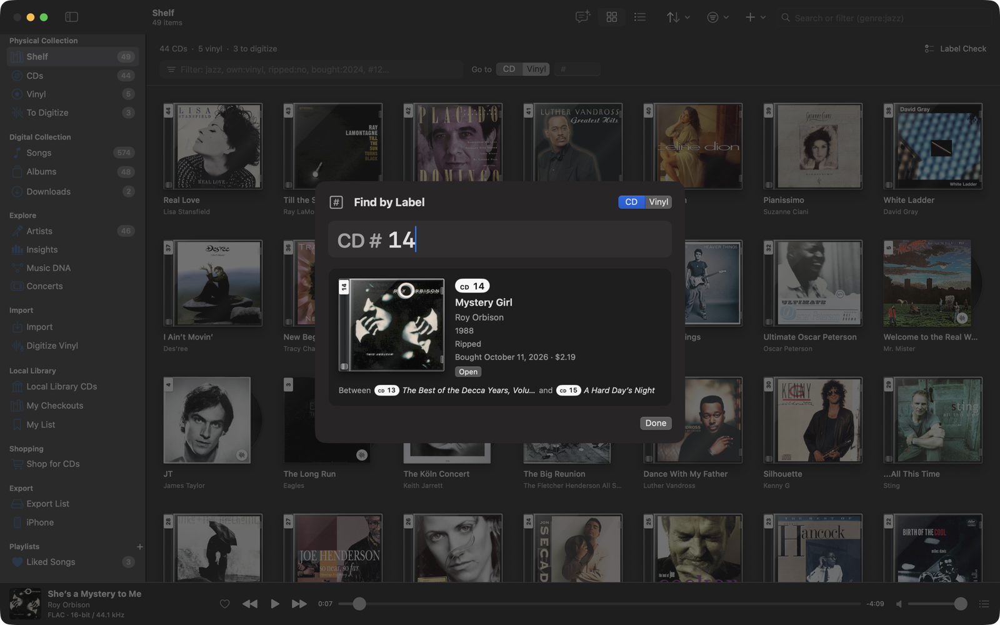

# Physical Collection

Your **Physical Collection** is everything on your shelf: the CDs you've ripped and the ones you haven't, and records
you may never digitize. Each one is an item with its own page, whether or not any of its music is in your digital
collection. Albums you bought as downloads are things you own too; they're listed with your music files under
**Downloads** in the Digital Collection.

## The Shelf

The sidebar's **Physical Collection** section has:

- **Shelf**: every CD and record.
- **CDs** and **Vinyl**: one medium each.
- **To Digitize**: the CDs and records with no digital copy yet (shown while there are any).

Show them as covers (each CD in its jewel case, each record in its sleeve) or as a list with the toolbar's layout
buttons. **Sort By** orders them by label (in sections of a hundred), artist, title, release year, date bought, price
or date added. The filter field takes the [collection search keys](search.md#collection-keys), such as `own:vinyl`,
`ripped:no` or `bought:2024`. **Go to** jumps to a label: pick CD or Vinyl and type the number.

The counts above the shelf ("44 CDs · 5 vinyl · 3 to digitize") are buttons that filter it, and **Label Check** lists
the free numbers and any duplicates in each series.

## Label numbers

CDs and records each have their own label series, both starting at 1 (up to 9,999,999). Number the cases on your shelf
the same way and you can always find one.

- On a cover, the number sits on a white strip across the top of a jewel case's hinge, or down the same edge of a
  record's sleeve. The sticker shows just the number; the case or sleeve tells you the series.
- In text, a label is always written with its series: **CD #12** and **Vinyl #12** are different things.
- When you add something, the next free number in its series is suggested. A number already taken in the same series
  is refused, with the next and the first free numbers offered instead.
- Hover a sticker or a badge for what it means (on the iPhone, press and hold it).

Covers carry a few badges:

| Badge | Means |
|---|---|
| A waveform with a slash | Not digitized yet: no digital copy of this CD or record |
| A dollar sign | You own it as a download |
| Two arrows | Not in your collection (an album you borrowed, for instance) |

## Adding to your collection

**Add to Physical Collection…** (⇧⌘N, in the **File** and **Physical Collection** menus, or the Shelf's **+**) asks for
the medium (**CD**, **Vinyl** or **Download**), then the barcode on the case, a few words of the album and artist, or
the catalog number. It lists the matching editions on MusicBrainz with their year, country, record label, catalog
number, format and barcode, and their covers. Pick yours, check the label number, the purchase date and the price,
and **Add**.

- **Add & Next** (⌥⌘↩) keeps the sheet open for the next one. With a USB barcode scanner, cataloging a stack is one scan
  and Return per CD.
- Something MusicBrainz doesn't list can be entered by hand ("Not on MusicBrainz? Enter it yourself").
- Albums already in your digital collection can be added from their page (**Your Copies ▸ Add a Copy**), from the Albums
  grid's context menu (**I Own This ▸ As CD/As Vinyl/As Download**), or many at once with **Physical Collection ▸ Add
  Albums You Own…**, numbered in the order shown.
- [Local Library CDs](local-library.md) and [Shop for CDs](shop-for-cds.md) say when you already have a CD ("In your
  physical collection: CD #142") and have **I Own This** to add it.

## Ripping, digitizing and linking

A CD or record doesn't need any music in your digital collection, but when there is some, the item links to it.

- **Insert a CD** and its page says which item it is ("This is CD #37 in your physical collection, not ripped yet") or
  offers to add it with the next label. The rip is linked to the item as soon as its first track is imported, so a
  cancelled rip leaves it marked not ripped. See [Ripping CDs](ripping-cds.md).
- **Catalog Without Ripping** on the CD page adds the disc with its cover and ejects it, for the discs you only want on
  the list.
- **Digitize…** on a record's page records it from your turntable. See [Digitizing vinyl](digitizing-vinyl.md).
- **Import a Transfer…** marks files you digitized elsewhere (a needle-drop) as a record's digital copy, and the Import
  page can mark any files as the digital copy of a CD or record. See [Importing music](importing.md#your-collection).
- **Link Digital Copy…** links an item to an album already in your digital collection.

Removing an album from your digital collection keeps its items: they keep the album's cover and are marked not ripped.

**Settings ▸ General ▸ Physical Collection** has two switches: **Ask whether a CD is yours when it's inserted** (off: a
CD you rip is added to your collection unless you say otherwise) and **Eject after cataloging** (on).

## Item pages

Click any CD or record to open its page.

- The case or sleeve with its label, and the release: record label, catalog number, country, format.
- **‹ Previous on Shelf** and **Next on Shelf ›** (⌘[ and ⌘]) walk along the shelf.
- **Digital Copy** says whether it's digitized (and from which copy), partly ripped, not ripped yet, or no longer in
  your digital collection, and offers what fits: **Rip Now** when the CD is in a drive, **Digitize…** or **Digitize the
  Rest…** for a record, **Import a Transfer…**, **Link…**, **Rip Again**.
- **Tracks**: the release's track list, a record's with its sides; songs not in your digital collection are dimmed.
- **Your Copy**: medium, label number, date bought, price paid, notes, edition and cover, all edited in place. A new
  cover can go to the digital album too.
- **Your Other Copies**, and the album's description, reviews and links.
- The **…** menu has **Change Cover…**, **Link Digital Copy…**, the queue and export items, **Digitize This Record…**,
  **Shop for This CD** and **Remove from Physical Collection…**.

An album page lists **Your Copies** (CDs, records and downloads), with what the album has cost you per play.

## Find by Label

**Find by Label** (⌘L, from anywhere) tells you what's at a label and what sits on either side of it, so you can go and
grab it.

Choose CD or Vinyl and type the number. **↑** and **↓** step along the shelf, **⇥** switches series, **↩** opens the
item. Typing a label in the search field (`#142`, `cd 142`, `vinyl 12`) shows the item above the results too.

Find by Label is also on the iPhone's Physical tab, on the Apple Watch (even away from the phone) and in Siri: "Find
CD 12 in Music Library". See [iPhone app](iphone.md#physical) and [Widgets and Apple Watch](widgets-and-watch.md).

## Label Check

**Label Check** (at the top of the Shelf, and in the Your Shelves panel of Insights' Owned pane) lists, for each series, the
range in use, the next number, the free numbers in between and any number used twice. Duplicates can come from older
versions of the app; they stay saveable, but a new duplicate is refused.

## Coming from an earlier version

The first time version 1.21 or later opens your library, every album you'd marked as owned becomes an item, with its
label number, purchase date and price: a CD on the Shelf, or a download under Downloads. Albums you bought songs from
appear as downloads too. Nothing you filed is lost or changed.

- Versions before 1.19 didn't record whether an album was a CD or a download, so albums marked owned with those versions
  read as CDs. Change the medium on the item's page if one was a download.
- iPhones on an older version of the app keep showing the CDs and downloads of the albums in your digital collection,
  but not your records.
- If you go back to an older version on the Mac, what you change there is picked up when you update again, except
  deleting an album's copy, which has to be done again. That older version doesn't see the label of a second CD of the
  same album, so it can suggest a number that's taken; **Label Check** finds it after updating.
