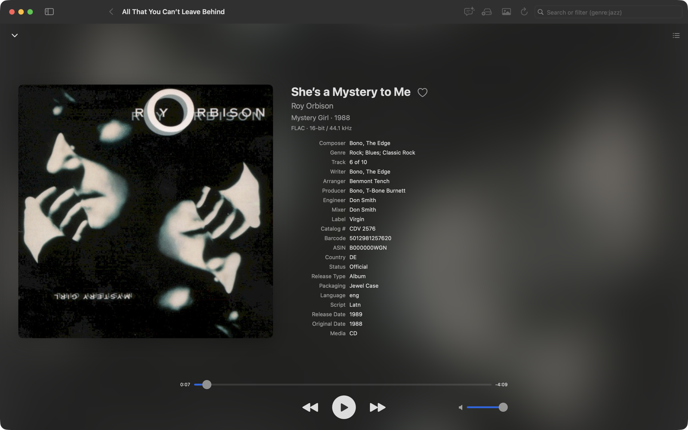
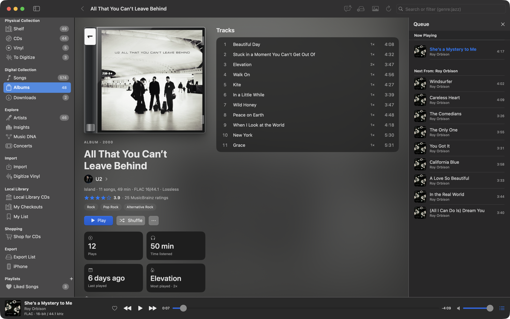

# Playback

Music Library plays your files as they are: each song at its own sample rate and bit depth, through whatever output
your Mac uses, with a real play queue.

## Bit-perfect output

With **Match output device sample rate to the song** on (Settings ▸ Playback, on by default), the app sets your output
device to each song's own sample rate before it plays: a 44.1 kHz CD rip plays at 44.1, a 24/96 file at 96. When a
device can't do a song's rate, it uses the closest rate that divides evenly (a multiple, then a divisor), so nothing is
resampled awkwardly. **Match output bit depth** also sets the device's bit depth to the song's.

- The player bar shows what's happening: "FLAC · 24-bit / 96 kHz → DAC 96 kHz / 24-bit". The output part turns orange
  when the device couldn't match the song ("Output device doesn't support 192 kHz; using 96 kHz").
- The format changes for every app while a song plays, and your device's original format is restored when you quit or
  turn the setting off.
- Devices with a fixed rate (Bluetooth, AirPlay) aren't affected.

Playback uses the output chosen in System Settings ▸ Sound.

## The player and Now Playing

The player bar along the bottom of the window has the song, a heart for Liked Songs, previous / play-pause / next, the
scrubber, volume, and the queue button. **Space** plays and pauses (except while typing).

Click the cover to expand **Now Playing**: a large cover, the song's details and credits (click a name for
[Music DNA](music-dna.md)), and whether it was scrobbled to Last.fm. **Esc** closes it.

## The play queue

The queue works like a streaming app's: the list you started playing from, plus songs you add.

- **Play Next** (in any song, album, artist or playlist menu) puts music right after the current song; songs added with
  Play Next always play next, in order.
- **Add to Queue** adds to the end.
- The queue pane (**View ▸ Show Queue**, ⌥⌘U, or the queue button) shows **Now Playing**, **Next in Queue** and **Next
  From** the album or playlist you started. Drag to reorder, press Delete to remove, **Clear** to empty your additions.

The queue and the position in the current song are saved when you quit and restored, paused, the next time.

## Playlists

- **Playlists**: **+** in the sidebar's Playlists header, then add songs from any song menu (**Add to Playlist**). Reorder
  by dragging; Delete removes songs.
- **Smart Playlists**: saved [searches](search.md#smart-playlists) that update themselves.
- **Liked Songs**: every song you've hearted, most recently liked first. Like songs from the player bar, song lists, the
  iPhone, its widget or the Apple Watch.

Playlists can be exported as `.m3u` files (see [Export and backup](export-and-backup.md)) and sync to the iPhone.

## Listening history

Every play is recorded: when, and whether it counted (half the song or four minutes, the same rule as Last.fm). Album
and artist pages show your plays and time listened, and [Insights](insights.md) turns it into a listening report.
Plays on the iPhone come back to the Mac at each sync.

## Last.fm

To scrobble what you play:

1. Create a free [Last.fm API account](https://www.last.fm/api/account/create) (the callback URL can stay empty).
2. Enter the API key and shared secret in **Settings ▸ Last.fm** and click **Connect…**, then allow access in your
   browser.

A song counts once you've listened to half of it or four minutes, whichever comes first (songs under 30 seconds don't
count). **Show what's playing now on my profile** updates your Last.fm "now playing". Scrobbles made offline wait in a
queue (**Waiting to send**) and go out when you're back online.

When you sync, an iPhone that isn't connected to Last.fm adopts the Mac's account. The iPhone scrobbles what it plays
itself, and the Mac doesn't scrobble those plays again.

## Song previews

Songs you don't own play as 30-second Apple Music previews in two places: CDs on [Local Library CDs](local-library.md)
and songs the [Radio DJ](radio-dj.md) mentions. Previews play apart from your queue and never count as plays or
scrobbles.
