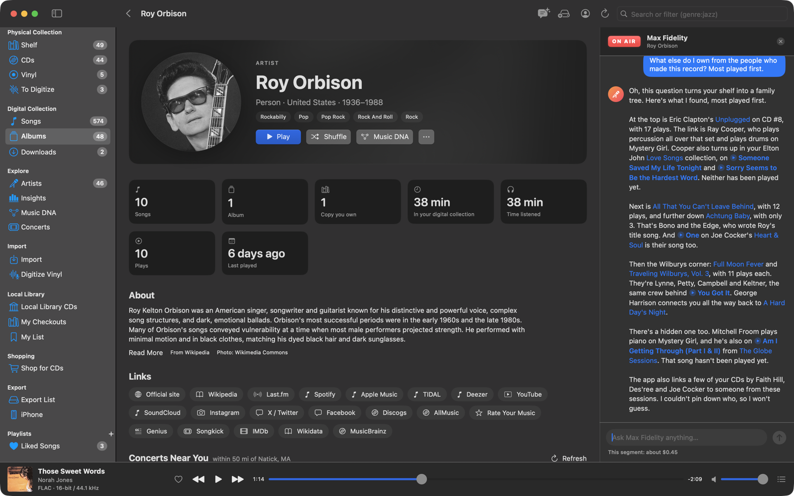

# Radio DJ

With your own Claude API key, Music Library has a radio DJ: press **On Air** and a host you name tells you the story
behind what you're looking at (who made it, who played on it, how it connects to everything else you own) and then
takes your questions, checking facts on the web as it talks and showing its sources. It can search your own collection
too. Without a key, none of this appears anywhere in the app.

## Set it up

1. Get an API key at [platform.claude.com](https://platform.claude.com) (you pay Anthropic for what you use; see
   [What it costs](#what-it-costs)).
2. In **Settings ▸ Radio DJ** on the Mac, paste it into **API key** and click **Check**. It's stored in your keychain.
3. Optionally name your DJ (**DJ's name**, Max Fidelity by default) and tell it **Your name**, which it uses now and
   then, like a regular caller.

The DJ picks the Claude model itself; there's nothing else to configure. The key, the DJ's name and yours go to your
iPhone at the next sync, so the DJ works there too. Remove the key on the Mac to turn the DJ off on both.

## On the air

**On Air** is in the window's toolbar on every page. Press it and a panel opens beside the page: the DJ says hello for
the time of day and offers a few questions to start with. The first, **Tell me about …**, opens a segment about where
you are, using what the app knows (credits, the track list, the album's description, your copies and your plays) and the
web. Or ask anything in **Ask … anything…**. Nothing is sent to Claude, and nothing costs anything, until you ask.

- **It knows where you are**: an album, an artist, a CD or record, the Shelf, Insights, a playlist, your search
  results.
- **It stays on while you browse.** Go to another album or artist and the panel offers **Tell me about …**, or just ask;
  the conversation keeps its history.
- **It searches your collection** when a question is about your music: "what else do I have by them, most played
  first?", "which of these do I own on vinyl?". The search runs on your device with the same search language as the
  search box (sorted by plays, last played, date added, year or title), and only the matching rows are sent.
- **It knows your numbers**: "how many minutes of Roy Orbison do I own?", "what did I play most this month?", from the
  same figures as [Insights](insights.md).
- **It checks the web** (searching and reading pages) and lists its sources under each answer.
- **It looks at photos**: show it a record or CD (see [Show it a photo](#show-it-a-photo)).
- **It helps you buy a copy** (on the Mac): ask it to find an album on CD or vinyl and it opens the [Shop](shop.md)
  searching for it, then tells you what came up. You pick the edition and the copy; it never buys anything.
- **It knows the time of day** where you are, so a 3 PM segment opens with a good afternoon, not a late-night hello.
- **Off Air** (or the panel's close button) ends the segment.

## Show it a photo

Holding a record in a shop and wondering whether you already have it, or what it's worth? Show the DJ a photo: the
cover, the spine, the back with its barcode, the label, or a whole crate.

- **On iPhone**, tap the camera button beside **Ask … anything…** to take a picture (touch and hold it to choose from
  your photo library instead).
- **On the Mac**, click the photo button beside the text field to choose files or paste an image, or drop images (from
  Finder, Photos or a web page) anywhere on the panel; ⌘V pastes one when the text field isn't being typed in.

Up to four photos go with a message. They show above the text field, where you can take one back, with a few questions
to ask about them: **What's this? Do I have it?**, **What else do I have by them?**, **What do the reviews say?**,
**What's a fair price for it?** and, on the Mac, **Find me a copy to buy**. Or type your own question, or send the photo
alone.

The DJ reads what's printed (artist, title, record label, catalog number, barcode, the matrix in the run-out groove) to
tell you what it is and which edition or pressing, and says how sure it is or which side to photograph next. It checks
your collection for the album and others by the artist, looks up reviews on the web, and, asked about price, checks what
that edition sells for (Discogs listings and sales, eBay sold listings, record stores) and gives a fair range for the
condition it can see or you describe. On the Mac it can open the [Shop](shop.md) on it to compare copies for sale.

Photos are scaled down (at most 2048 pixels on the long side) and saved again as JPEG before they're sent, so their
location and camera details stay on your device. They're part of the conversation, so later questions can refer back to
them; a photo costs about two cents the first time it's sent and much less after that.

## Links in what it says

- **Things you own** are links in the accent color: an artist or album opens its page (the DJ stays on the air), and a
  song gets a play button that plays it in its album.
- **Songs you don't own** get a headphones button that plays a 30-second Apple Music preview.
- **Artists and albums you don't own** link to their Wikipedia article, but only after the app has checked that the
  article is about them (going through disambiguation pages when needed); otherwise they stay plain text. These links
  are light red.

On the Mac, right-click the DJ's text to copy it.

## On iPhone

The DJ's button (a radio icon) is at the top of every page once the key has synced. Tap it and the DJ comes on in a
sheet that floats over every tab; links push pages onto the tab you're on. Swipe the sheet down (or tap the chevron) to
keep browsing with the DJ still on the air; the button turns red, and tapping it brings the DJ back. Songs play only if
they're on the phone; others link to their album.

## What it costs

The DJ uses the Claude API with your key, so Anthropic bills you for it. Settings ▸ Radio DJ shows an estimate at
Claude API list prices (Claude Opus 5.5: $4 per million input tokens and $20 per million output tokens; web searches
$10 per 1,000): **This month**, **All time**, how many segments and web searches, and per device (each iPhone's
spending arrives with its next sync). Months are calendar months in UTC, as Anthropic bills. The panel shows what the
current segment has cost so far ("This segment: about $0.12").

Going on the air is free; a typical opening segment with a couple of follow-up questions costs a few tens of cents. Your actual bill is at
[platform.claude.com](https://platform.claude.com).

## Privacy

What the DJ sends to Anthropic: the page's details (the album or artist, its credits, track list and description, your
copies and plays of it), your questions and any photos you show it (without their location or camera details), the rows
of any collection search it runs, and what the Shop found when it opens it for you. Your library itself never
leaves your device. See [Privacy](privacy.md).
