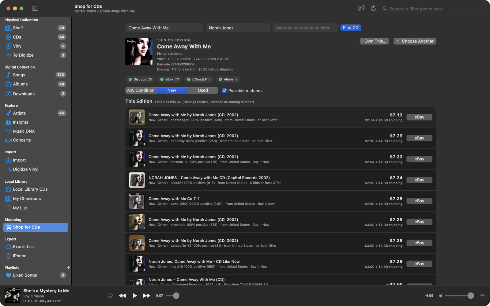

# Shop

**Shop** (sidebar **Acquire**; **Shop for This CD** or **Shop for It on Vinyl** in an album's **…** menu; **Shop for
This CD** or **Shop for This Record** in a CD's or record's **…** menu) finds the exact CD or record you want on
MusicBrainz and compares new and used copies that ship to the US, from several stores at once, with shipping and a
total in dollars, plus a [price guide](#price-guide) of what it's worth. The [Radio DJ](radio-dj.md) can open it for
you, too. On the iPhone, the [Shop tab](#on-iphone) is made for record stores and fairs: look a record up by name or
barcode, or show the AI a photo of it.

No accounts are needed. Connecting Discogs (on the Mac) and signing in to eBay (optional, in **Settings ▸ Shop**) add
more to the price guide.

## Find the CD or record

Pick **CD** or **Vinyl**, then search by **Album** and **Artist** (a few words of each are enough), or by the **Barcode
or catalog number** on the case or sleeve, and press **Find**. Switching between CD and Vinyl runs the same search again
in the other format.

- Results are grouped by album, with official editions first. **Any CD Edition** (or **Any Vinyl Edition**) shops for
  every edition of the album in that format; open an album to see its editions (year, country, label, catalog number,
  barcode, format such as 2×12" Vinyl, packaging) and pick one with **Shop This Edition**.
- An artist alone lists their discography: studio albums first, then live albums, compilations and EPs, with other
  close name matches as chips.
- A CD or record MusicBrainz doesn't list: **Search the stores by name**.
- **I Own This…** adds the edition to your [Physical Collection](physical-collection.md), as a CD or a record.

## Compare offers

The app reads the stores' listings for you:

- **Discogs** marketplace listings of the exact release, or of the master in the format you picked, shipping to the US,
  by price.
- **eBay** Music CDs or Records, by barcode and by keywords, by price plus shipping.
- **CDandLP** and **Alibris** keyword searches, keeping the listings in your format.

Offers are filtered (other formats, lots and box sets of other things are dropped, and keyword results must name the
album and artist), deduplicated and sorted with the best matches first: **This Edition** (listings carrying the
edition's catalog number or barcode), then **This Album on CD** (or **on Vinyl**), then **Possible Matches**. Within
each, cheapest total first, converted to dollars at the day's European Central Bank rates.

- Click a store's chip to show or hide it; choose **Any Condition**, **New** or **Used**.
- Discogs' own marketplace summary (lowest price, how many for sale) is shown with the edition, and the
  [price guide](#price-guide) under it.
- **Search on** links open each store's own search, including Amazon, Walmart, Half Price Books and Barnes & Noble.
- Right-click an offer for **Open on …** or **Copy Link**.

Results are kept for half an hour per CD or record; **Refresh** looks again. The stores are read one page at a time, a
few seconds apart, and only when you ask.

## Price guide

What the album (or the edition you picked) is worth, on the Mac under the album you're shopping for and on the iPhone on
each album's page:

- **A fair price** to lead with: the middle half of what used copies recently sold for on eBay (when you're signed in
  to eBay), else Discogs' suggested prices for a playable copy (Very Good to Near Mint), else what used copies are listed
  for on eBay now, else the cheapest copy on Discogs.
- **Discogs**: for a few editions (the one you picked or scanned, the most collected one and the original, or the latest
  reissue), how many are for sale and from what price, and how many people have and want it. With your Discogs account,
  Discogs' **suggested prices by condition** (Mint down to Good; Discogs gives them only to accounts with seller settings
  filled in) and the versions already in **your Discogs collection**. Also how many copies of any edition are for sale.
- **eBay**: what copies listed now ask (used and new, middle half and median; running auctions left out), and, signed in
  to eBay, what copies **sold for recently**. Listings of other albums, other formats and lots are left out; titles that
  carry the edition's catalog number are counted on their own.

Prices are before shipping. They're in your currency where Discogs has it (eBay's are in dollars).

## Track list and Apple Music

Under the price guide (the Mac) or on the album's page (the iPhone), **Tracks** lists the album's songs as Apple Music
has them, found by the barcode when there is one, else by artist and title:

- Click (or tap) a song for its 30-second preview; the next song's follows. **Play Previews** plays them all in a row.
  Your own music pauses while a preview plays, and previews never go into your queue, history or Last.fm.
- **Open in Apple Music** opens the album in the Music app, where Apple Music subscribers can play it right away. Right-
  click (or press and hold) a song for **Open Song in Apple Music**.

Apple's catalog doesn't have every release (and may list a different edition's songs); when it can't find the album,
the page says so.

## Recent Finds

Every album priced in the Shop, on the Mac or the iPhone, is kept in **Recent Finds** (the last 100, newest first): on
the Mac in the Shop before you search, on the iPhone under the search. Click or tap one to open it again; delete it to
remove it (on both devices). They're kept in the library, so they sync between the Mac and the iPhone (Wi-Fi sync and
iCloud) and are in your iCloud backup. The photo you showed the DJ stays on the iPhone.

### Discogs account

Connect Discogs on the Mac in **Settings ▸ Discogs** (the same personal access token [Sync to
Discogs](physical-collection.md#sync-to-discogs) uses). Your iPhone gets it with the next sync.

### eBay sold prices

eBay shows sold listings only to signed-in visitors. To include them, choose **Sign In to eBay…** in **Settings ▸ Shop**
(on the Mac and on the iPhone, each signed in on its own). You sign in on eBay's own page: Music Library never sees your
password, it only keeps the cookies eBay sets, and reads a sold search only when you look an album up. If eBay asks you
to sign in again later, the price guide says so. **Sign Out** forgets eBay's cookies.

## On iPhone

The **Shop** tab:

- **Look it up**: type an artist and album (or a barcode) and pick **Vinyl**, **CD** or **Any Format**, or tap **Scan
  Barcode** and point the camera at the barcode on the back. Results come from Discogs; a barcode that names one album
  opens it straight away.
- **An album's page**: whether you have it already (the copies on your shelf, with their labels, and the album in your
  digital library; tap one to open it), the [price guide](#price-guide), and **Find a Copy**: each store's own search
  for it (Discogs, eBay, CDandLP, Alibris, Amazon, Walmart, Half Price Books, Barnes & Noble). Switch the format at the
  top to see the other format's editions and prices.
- **Add to Buy List** on an album's page keeps it on your [Buy List](#buy-list), with its prices.
- **Tracks** with Apple Music previews, and **Open in Apple Music** (see [Track list and Apple Music](#track-list-and-apple-music)).
- **Recent Finds**: the albums you looked up here or on the Mac, with the fair price, newest first (swipe to delete).
  See [Recent Finds](#recent-finds).

## Buy List

The albums you're looking for, with what each goes for now. It's on the Mac (**Acquire ▸ Buy List**) and the iPhone (the
**Collection** tab, and the top of the **Shop** tab), and it's the same list on both: what you add or change on one shows
on the other after the next sync (Wi-Fi or iCloud).

- **Add an album**: **Add to Buy List** on an album you priced in the Shop (on the iPhone, after looking it up or scanning
  its barcode), on a [Local Library CD](local-library.md), or **+** to add one by name. With a barcode or catalog number
  it's that edition; otherwise the cheapest copy of any edition in the format (CD, Vinyl or Any Format).
- **What it goes for**: the big price is the cheapest copy for sale now (on Discogs, or eBay's typical asking price for
  a used copy), with an arrow when it moved since the check before; under it, the **fair** price from recent eBay sales
  or Discogs' suggestions by condition. Open an album for its price history, the figures from each store, notes and
  the full price guide with each store's search.
- **The most you'd pay**: set it (**Edit**) and the album is marked **At or under your max** when something's asking
  that or less; deals go to the top of the list, and **Deals** on the Mac shows only those.
- **Refresh Prices** checks every album not checked in the last six hours, one at a time, as the Shop would (Discogs,
  and eBay's listings and recent sales); **Refresh** on one checks just it. Looking an album up in the Shop updates its
  price too.
- **I Got It…** (Mac) adds it to your Physical Collection; the list then says **You own it now**, and you can remove it.
- With the Radio DJ on, **Ask (your DJ's name)** about an album on the list (Mac), and the DJ can see the list when you're
  on its page.

The top of the list says how many albums you're after, about what they'd cost at fair prices and how many are deals
now; the **Owned** pane of [Insights](insights.md#owned) has the same as a card.

## Your crate-digging friend

With the [Radio DJ](radio-dj.md) on, the Shop has an AI of its own: not the radio host, but a friend who comes record
shopping with you. It's a savvy bargain hunter and an obsessed audiophile collector who knows pressings and masterings,
matrix codes, audiophile reissues and which CDs are brickwalled, cares about value, and will tell you to walk away from
a bad deal.

- **On iPhone**: tap **Show (your DJ's name) a Record** at the top of the Shop tab, and the camera opens. Snap the cover
  (or the back, for the barcode and catalog number). If it can't tell which record it is, it puts the likely albums on
  screen to tap, or asks for another photo (of the back, the label or the barcode) with a button to take it. Then it
  looks the record up in the price guide and your collection and gives you its take: what it is and how it's rated,
  whether this pressing is the one to own, whether it's worth adding to your collection, a fair price for the condition
  and what to check before paying. Keep snapping records: the conversation goes on (**New Dig** starts over), and each
  one it prices joins **Recent Finds**. A model that can't see photos can still be told what the cover says. On an
  album's page, **Ask (your DJ's name) About It** does the same for an album you looked up.
- **On the Mac**: **Ask (your DJ's name)** next to the album you're shopping for puts it on the air in that voice, asked
  what it is, whether it's worth adding and what to pay.

What it says costs the same as the DJ (see [What it costs](radio-dj.md#what-it-costs)).

## Ask the DJ

With the [Radio DJ](radio-dj.md) on the air, ask it to help you find an album ("I'd love this on vinyl, can you find me
a copy?"). It works out which album you mean, asks CD or vinyl if you haven't said, and opens the Shop searching for
it, then tells you what came up and which edition to pick if it matters. You choose the edition and the copy; the DJ
never buys anything. Once you've picked one, it can see the cheapest listings and talk them over. Anywhere, it can look
up the [price guide](#price-guide) for an album you ask about.
