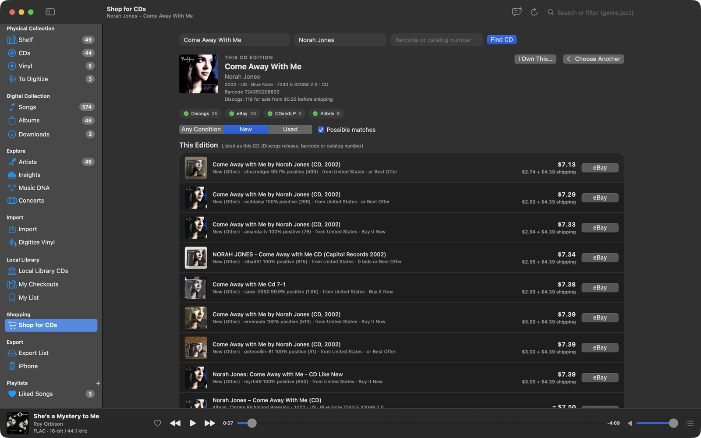

# Shop

**Shop** (sidebar **Acquire**; **Shop for This CD** or **Shop for It on Vinyl** in an album's **…** menu; **Shop for
This CD** or **Shop for This Record** in a CD's or record's **…** menu) finds the exact CD or record you want on
MusicBrainz and compares new and used copies that ship to the US, from several stores at once, with shipping and a
total in dollars. No accounts or sign-ins. The [Radio DJ](radio-dj.md) can open it for you, too.

## Find the CD or record

Pick **CD** or **Vinyl**, then search by **Album** and **Artist** (a few words of each are enough), or by the **Barcode
or catalog number** on the case or sleeve, and press **Find**. Switching between CD and Vinyl runs the same search again
in the other format.

- Results are grouped by album, with official editions first. **Any CD Edition** (or **Any Vinyl Edition**) shops for
  every edition of the album in that format; open an album to see its editions (year, country, label, catalog number,
  barcode, format such as 2×12" Vinyl, packaging) and pick one with **Shop This Edition**.
- An artist alone lists their discography: studio albums first, then live albums, compilations and EPs, with other
  close name matches as chips.
- A CD or record MusicBrainz doesn't list: **Search the stores by name**.
- **I Own This…** adds the edition to your [Physical Collection](physical-collection.md), as a CD or a record.

## Compare offers

The app reads the stores' listings for you:

- **Discogs** marketplace listings of the exact release, or of the master in the format you picked, shipping to the US,
  by price.
- **eBay** Music CDs or Records, by barcode and by keywords, by price plus shipping.
- **CDandLP** and **Alibris** keyword searches, keeping the listings in your format.

Offers are filtered (other formats, lots and box sets of other things are dropped, and keyword results must name the
album and artist), deduplicated and sorted with the best matches first: **This Edition** (listings carrying the
edition's catalog number or barcode), then **This Album on CD** (or **on Vinyl**), then **Possible Matches**. Within
each, cheapest total first, converted to dollars at the day's European Central Bank rates.

- Click a store's chip to show or hide it; choose **Any Condition**, **New** or **Used**.
- Discogs' own marketplace summary (lowest price, how many for sale) is shown with the edition.
- **Search on** links open each store's own search, including Amazon, Walmart, Half Price Books and Barnes & Noble.
- Right-click an offer for **Open on …** or **Copy Link**.

Results are kept for half an hour per CD or record; **Refresh** looks again. The stores are read one page at a time, a
few seconds apart, and only when you ask.

## Ask the DJ

With the [Radio DJ](radio-dj.md) on the air, ask it to help you find an album ("I'd love this on vinyl, can you find me
a copy?"). It works out which album you mean, asks CD or vinyl if you haven't said, and opens the Shop searching for
it, then tells you what came up and which edition to pick if it matters. You choose the edition and the copy; the DJ
never buys anything. Once you've picked one, it can see the cheapest listings and talk them over.
